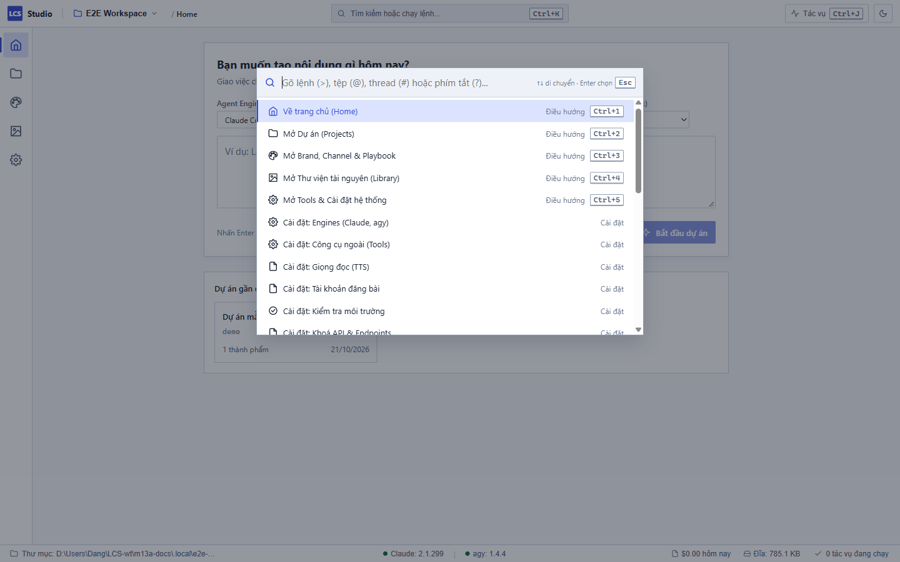

# Bảng lệnh và Phím tắt — Local Content Studio

Bảng lệnh (Command Palette) và hệ thống phím tắt giúp bạn điều khiển toàn bộ Local Content Studio nhanh chóng bằng bàn phím mà không cần rê chuột tìm kiếm qua nhiều thanh bảng điều khiển.

---

## 1. Mở Bảng lệnh (Command Palette)

1. Nhấn tổ hợp phím **`Ctrl+K`** trên bàn phím (hoặc bấm vào thanh tìm kiếm trên thanh tiêu đề ứng dụng).
2. Một hộp thoại tìm kiếm sẽ mở ra ở giữa màn hình.
3. Khi hộp thoại vừa mở và ô nhập còn trống, màn hình sẽ hiển thị tối đa **10 lệnh bạn vừa sử dụng gần đây nhất** (Gần đây · ...).
4. Nhập từ khoá bạn muốn tìm:
   - Hệ thống tìm kiếm mờ (Fuzzy Search) tự động hiểu tiếng Việt không dấu: ví dụ gõ `cai dat` sẽ khớp với các lệnh `Cài đặt`.
   - Các chữ cái khớp với từ khoá bạn gõ sẽ được tô đậm màu cam/vàng.
5. Dùng phím mũi tên **`↑`** hoặc **`↓`** để di chuyển lên xuống giữa các mục trong danh sách.
6. Nhấn **`Enter`** để chạy ngay lệnh đang chọn.
7. Nhấn **`Esc`** để đóng bảng lệnh bất kỳ lúc nào. Nhấn phím **`Tab`** để giữ nguyên tiêu điểm trong ô nhập mà không bị thoát ra ngoài.

> [!NOTE]
> Studio tuân thủ nguyên tắc không sử dụng tổ hợp phím `Ctrl+Shift` nhằm tránh xung đột với các bộ gõ tiếng Việt thông dụng như UniKey hay EVKey.

---

## 2. Các tiền tố tìm kiếm nhanh (`>`, `@`, `#`, `?`)

Bạn có thể gõ ngay một ký tự tiền tố ở đầu ô nhập để chuyển đổi chế độ tìm kiếm:

| Tiền tố | Chế độ | Mô tả và những gì bạn thấy trên màn hình |
| :--- | :--- | :--- |
| **`>`** *(hoặc để trống)* | **Lệnh hệ thống** | Tìm kiếm tất cả các lệnh thao tác trong ứng dụng (điều hướng, chuyển theme, render, lưu file...). |
| **`@`** | **Tệp trong dự án** | Liệt kê và tìm nhanh các tệp tin trong dự án hiện tại. Bấm chọn tệp để mở trực tiếp trên khung Stage biên tập. |
| **`#`** | **Hội thoại (Thread)** | Tìm kiếm nhanh các phiên hội thoại AI trong dự án theo tên hoặc engine (Claude / agy). Bấm chọn để chuyển ngay tới luồng chat đó. |
| **`?`** | **Danh sách phím tắt** | Lọc và hiển thị toàn bộ các lệnh có gán phím tắt thao tác nhanh trong Studio. |

---

## 3. Bảng tra cứu phím tắt đầy đủ

Dưới đây là danh sách toàn bộ phím tắt được cài đặt sẵn trong ứng dụng:

### Điều hướng khu vực chính (Nav)

| Phím tắt | Lệnh thao tác | Ý nghĩa |
| :--- | :--- | :--- |
| **`Ctrl+1`** | Về trang chủ (Home) | Quay về màn hình tổng quan Home |
| **`Ctrl+2`** | Mở Dự án (Projects) | Mở không gian làm việc dự án, khung chat và Stage |
| **`Ctrl+3`** | Mở Brand, Channel & Playbook | Quản lý thương hiệu, định dạng kênh và quy trình |
| **`Ctrl+4`** | Mở Thư viện tài nguyên (Library) | Quản lý kho ảnh, video, âm thanh và tư liệu |
| **`Ctrl+5`** | Mở Tools & Cài đặt hệ thống | Truy cập cấu hình engine, API key, web LAN... |

### Thao tác làm việc & Giao diện

| Phím tắt | Lệnh thao tác | Ý nghĩa |
| :--- | :--- | :--- |
| **`Ctrl+K`** | Mở / Đóng Bảng lệnh (Command Palette) | Bật hộp tìm kiếm lệnh và tệp |
| **`Ctrl+J`** | Mở / Đóng Trung tâm Tác vụ (Task Center) | Xem danh sách các tiến trình AI và render nền |
| **`Ctrl+B`** | Ẩn / Hiện khung hội thoại (Thread Pane) | Mở rộng không gian Stage khi muốn tập trung xem |
| **`Ctrl+Alt+B`** | Ẩn / Hiện khung Outputs & Checkpoints | Ẩn hiện cột thành phẩm bên phải |
| **`Ctrl+S`** | Lưu thay đổi tệp trên Stage | Lưu tức thì nội dung tệp đang soạn thảo trên Stage |
| **`Esc`** | Đóng cửa sổ nổi | Đóng Bảng lệnh, Task Center hoặc hộp chọn Workspace |

---

## 4. Thanh trạng thái (Status Bar) có thể bấm tương tác

Ở góc dưới cùng của cửa sổ ứng dụng, Thanh trạng thái không chỉ hiển thị thông tin mà còn hỗ trợ nhấp chuột để điều hướng nhanh:

1. **Thư mục Workspace:** Bấm vào để mở nhanh hộp thoại chuyển đổi hoặc tạo Workspace mới (`workspace.switch`).
2. **Engine AI (Claude / agy):** Bấm vào biểu tượng engine để mở ngay tab **Cài đặt › Engines** nhằm kiểm tra trạng thái CLI.
3. **Dung lượng Đĩa:** Bấm vào chỉ số dung lượng để mở tab **Cài đặt › Dung lượng đĩa** xem chi tiết và dọn dẹp bộ nhớ đệm.
4. **Trung tâm Tác vụ:** Bấm vào số tác vụ đang chạy để mở ngăn kéo Task Center (`Ctrl+J`).
5. **Chi phí hôm nay:** Hiển thị mức sử dụng ngân sách `$x / $y` trong ngày; bấm vào để chuyển thẳng tới tab **Cài đặt › Cấu hình tác vụ**.

---

## 5. Xử lý khi gặp sự cố

| Hiện tượng | Nguyên nhân | Cách xử lý |
| :--- | :--- | :--- |
| Bấm `Ctrl+K` nhưng không hiện bảng lệnh | Tiêu điểm đang nằm trong một trường nhập liệu khác hoặc ứng dụng mất focus | Bấm chuột vào bất kỳ vùng trống nào trong ứng dụng rồi bấm lại `Ctrl+K`. |
| Gõ từ khoá không thấy lệnh mong muốn | Một số lệnh có điều kiện hiển thị ngữ cảnh (ví dụ: lệnh Render chỉ xuất hiện khi dự án đã chọn một artifact) | Chọn dự án và artifact trước, hoặc dùng lệnh điều hướng cơ bản. |
| Bị nhảy ký tự tiếng Việt khi gõ phím tắt | Trình gõ tiếng Việt (UniKey/EVKey) ở chế độ gõ tự do | Kiểm tra không nhấn kèm phím Shift. Studio đã tối ưu để không kẹt bộ gõ. |
