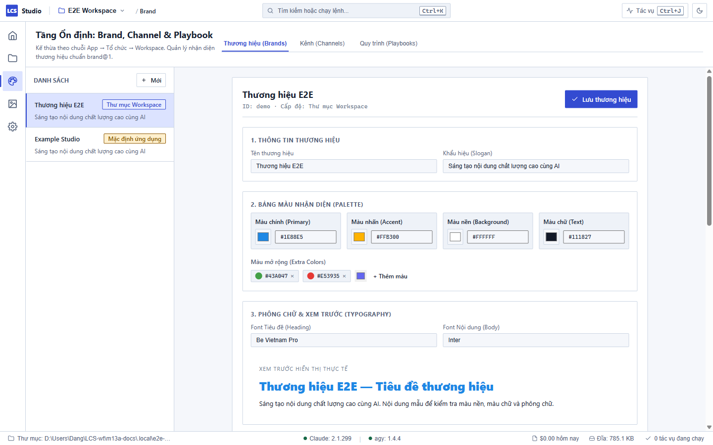
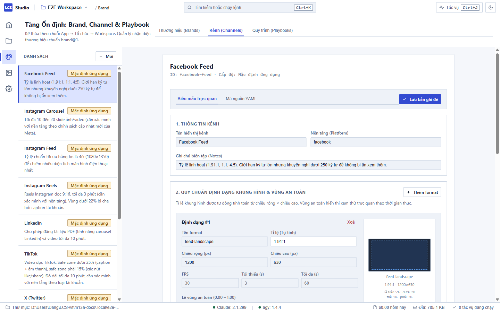
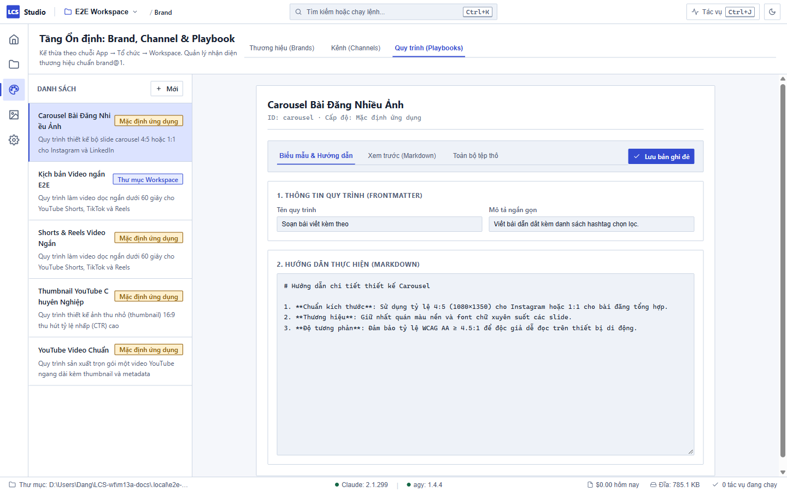

# Quản lý Brand, Kênh và Quy trình — Local Content Studio

Khu vực **Brand, Channel & Playbook** (truy cập bằng phím tắt **`Ctrl+3`**) là trung tâm định hình nhận diện thương hiệu, tiêu chuẩn xuất bản trên từng nền tảng mạng xã hội và quy trình sáng tạo nội dung của bạn.

---

## 1. Chuỗi phạm vi kế thừa (Scope Chain: App → Org → Workspace)

Studio tổ chức cấu hình theo 3 tầng kế thừa thông minh:

1. **Mặc định ứng dụng (App):** Các mẫu được cung cấp sẵn theo phần mềm (nằm trong tầng chỉ đọc). Được đánh dấu bằng huy hiệu màu vàng: **`Mặc định ứng dụng`**. Bạn không bao giờ lo bị xoá hay làm hỏng cấu hình gốc.
2. **Tổ chức (Org):** Cấu hình cấp nhóm/tổ chức (nếu có), kế thừa từ tầng ứng dụng. Đánh dấu bằng huy hiệu màu xám: **`Tổ chức`**.
3. **Thư mục Workspace (Workspace):** Cấu hình riêng cho không gian làm việc hiện tại của bạn. Đánh dấu bằng huy hiệu màu xanh: **`Thư mục Workspace`**.

Khi bạn chỉnh sửa một Brand hoặc Kênh thuộc tầng App hay Org, Studio sẽ tự động **tạo một bản ghi đè ở Workspace** mà không làm thay đổi tệp gốc của hệ thống.

---

## 2. Quản lý Thương hiệu (Brand)

### Chỉnh sửa và ghi đè thương hiệu có sẵn

1. Nhấn **`Ctrl+3`** để mở màn hình Thương hiệu.
2. Chọn tab **Thương hiệu** (Brands) ở góc trên.
3. Ở danh sách bên trái, nhấp chọn thương hiệu bạn muốn chỉnh sửa (ví dụ: `demo` hoặc `example`).
4. Biểu mẫu chỉnh sửa bên phải gồm 7 mục trực quan:
   - **Mục 1 — Thông tin chung:** Đặt tên thương hiệu và khẩu hiệu (tagline).
   - **Mục 2 — Bảng màu nhận diện:** Chọn 5 màu chuẩn bằng bảng mã Hex: màu chính (primary), màu phụ (secondary), màu nền (background), màu chữ (text), và màu nhấn (accent).
   - **Mục 3 — Kiểu chữ:** Khai báo font chữ tiêu đề (heading font) và font chữ nội dung (body font).
   - **Mục 4 — Logo & Biểu trưng:** Nhập đường dẫn tệp biểu tượng (như `logo.svg`, `mark.svg`) và xem trước ngay hình ảnh hiển thị.
   - **Mục 5 — Giọng điệu & Ngôn từ thương hiệu:** Quy định giọng văn (thân thiện, chuyên nghiệp, truyền cảm hứng...), danh sách từ khoá ưu tiên và danh sách từ cấm dùng.
   - **Mục 6 — Quy chuẩn hình ảnh & Video:** Định dạng khung hình ưu tiên (16:9, 9:16) và phong cách thẩm mỹ.
   - **Mục 7 — Áp brand lên mẫu (Thumbnail Preview):** Khung xem trước trực tiếp mẫu thumbnail 16:9 trong môi trường cô lập (sandbox), tự động hiển thị logo, màu nhấn và font chữ vừa cấu hình mà không tốn chi phí gọi AI.
5. Bấm nút **Lưu bản ghi đè** ở góc trên bên phải:
   - Studio sẽ sao chép toàn bộ thư mục thương hiệu (bao gồm cả tệp YAML lẫn các tệp nhị phân như logo ảnh, font chữ) sang thư mục `brands/<id>/` trong Workspace của bạn.
   - Một điểm kiểm tra (checkpoint) tự động được tạo để bảo đảm an toàn dữ liệu.
   - Trên danh sách, mục này sẽ chuyển sang trạng thái có huy hiệu **`Đang ghi đè`**.

### Tạo thương hiệu mới

1. Bấm nút **Mới** ở đầu danh sách bên trái.
2. Một hộp thoại hiện ra, nhập mã định danh (ID) bằng chữ cái viết thường và dấu gạch nối (ví dụ: `ca-phe-viet`).
3. Bấm **Tạo mới**. Studio sẽ sinh tệp mẫu hợp lệ để bạn bắt đầu tuỳ biến.

### Gỡ bản ghi đè (Quay về mặc định)

1. Khi đang xem một thương hiệu có huy hiệu **`Đang ghi đè`**, bạn sẽ thấy nút **Bỏ bản ghi đè**.
2. Bấm **Bỏ bản ghi đè** và xác nhận trên hộp thoại cảnh báo.
3. Bản cấu hình trong Workspace sẽ được xoá an toàn (có lưu checkpoint hoàn tác), và hệ thống tự động quay lại sử dụng cấu hình gốc từ tầng App.

---

## 3. Quản lý Kênh phát hành (Channels)

Mỗi kênh (YouTube, TikTok, Facebook, Instagram...) chứa các quy định ngặt nghèo về độ phân giải, tỉ lệ khung hình, thời lượng và vùng an toàn (Safe Zone):

1. Nhấn **`Ctrl+3`** → chọn tab **Kênh phát hành** (Channels).
2. Chọn một kênh ở cột bên trái (ví dụ: `youtube`, `tiktok`, `facebook`).
3. Giao diện cung cấp hai chế độ xem:
   - **Form trực quan:** Cho phép thêm hoặc sửa từng định dạng (format). Hệ thống **tự động tính toán tỉ lệ khung hình** khi bạn nhập chiều rộng (Width) và chiều cao (Height), hiển thị số khung hình/giây (FPS), thời lượng tối thiểu/tối đa, và giới hạn ký tự tiêu đề/mô tả.
   - **Xem trước Vùng an toàn (Safe Zone Preview):** Khung hiển thị mô phỏng 4 cạnh lề an toàn (trên, dưới, trái, phải). Các chi tiết quan trọng và phụ đề cần nằm gọn trong vùng an toàn này để không bị che khuất bởi giao diện nút bấm của mạng xã hội.
   - **Tab YAML:** Cho phép bạn xem và chỉnh sửa trực tiếp mã nguồn cấu hình. Trước khi lưu, hệ thống luôn thẩm định cú pháp (validate schema) tự động; nếu phát hiện sai sót sẽ chỉ rõ số dòng, cột bị lỗi để bạn khắc phục.
4. Bấm **Lưu bản ghi đè** để áp dụng chuẩn riêng cho workspace của bạn.

---

## 4. Quản lý Quy trình nội dung (Playbooks)

Quy trình (Playbook) là sổ tay hướng dẫn từng bước để các AI Agent (Claude, agy) phối hợp sản xuất nội dung đúng định hướng:

1. Nhấn **`Ctrl+3`** → chọn tab **Quy trình** (Playbooks).
2. Chọn một quy trình mẫu (ví dụ: `shorts`, `youtube-video`).
3. Trình biên tập gồm:
   - **Thông tin tiêu đề & mô tả:** Chỉnh sửa nhanh qua biểu mẫu ở phần đầu.
   - **Trình soạn thảo Markdown:** Viết nội dung hướng dẫn chi tiết theo định dạng Markdown.
   - **Xem trước (Preview):** Hiển thị văn bản kết xuất đẹp mắt, rõ ràng.
4. Sau khi lưu, agent sẽ tự động nhận biết quy trình mới khi bạn gọi qua ký tự `/` trong khung hội thoại dự án.

---

## 5. Xử lý khi gặp sự cố

| Bạn thấy trên màn hình | Nguyên nhân | Cách khắc phục |
| :--- | :--- | :--- |
| Huy hiệu **`Lỗi cấu hình`** màu đỏ trên danh sách | Tệp YAML hoặc Markdown bị sai cú pháp (thiếu thụt đầu dòng, ký tự đặc biệt không đóng ngoặc...) | Nhấp vào mục đó, xem thông báo đỏ hiển thị chính xác **dòng X, cột Y** bị lỗi. Chuyển sang tab YAML để sửa lại đúng cú pháp rồi lưu lại. |
| Không thể xoá cấu hình gốc tầng App | Tầng ứng dụng là chỉ đọc để đảm bảo ứng dụng luôn chạy ổn định | Bạn chỉ có thể "Bỏ bản ghi đè" nếu đã tạo bản ở Workspace; cấu hình mặc định đi theo bộ cài đặt không thể bị xoá. |
| Ảnh logo không hiển thị trong bản ghi đè | Đường dẫn tệp logo trong `brand.yaml` không đúng hoặc chưa chép file | Đảm bảo tệp ảnh logo (SVG, PNG) được đặt ngay trong thư mục `brands/<id>/` của workspace và khai báo tên tệp tương đối trong biểu mẫu. |
