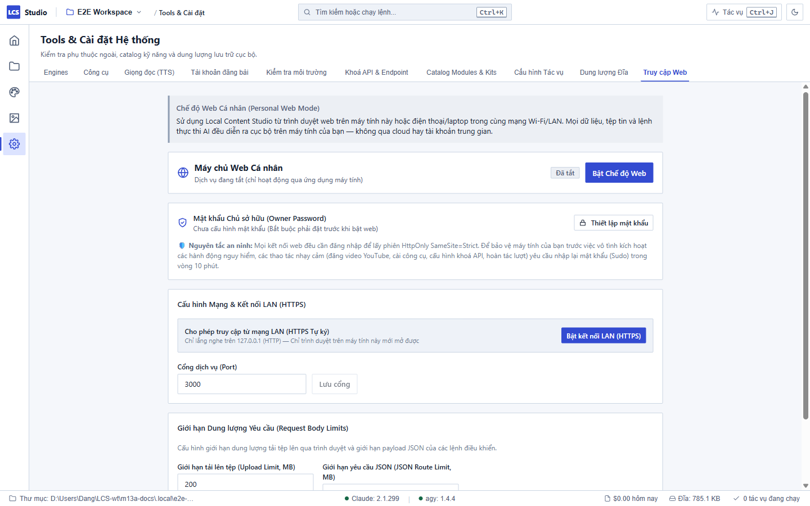

# Chế độ Web Cá nhân (Personal Web Mode) — Local Content Studio

Chế độ Web Cá nhân cho phép bạn điều khiển và theo dõi Local Content Studio từ trình duyệt web trên điện thoại, máy tính bảng hoặc laptop khác khi đang kết nối trong cùng mạng Wi-Fi/LAN gia đình.

Tất cả tác vụ, luồng xử lý AI, công việc render và tệp tin lưu trữ đều tiếp tục chạy trực tiếp trên máy tính chính của bạn. Đây là chế độ dành riêng cho **một chủ sở hữu duy nhất (single-owner)**, không cần qua bất kỳ máy chủ đám mây hay bên trung gian nào.

---

## 1. Kích hoạt Chế độ Web trong Studio

1. Mở ứng dụng Local Content Studio trên máy tính chính.
2. Nhấn **`Ctrl+5`** để mở **Tools & Cài đặt** → Chọn tab **Truy cập Web cá nhân** (Web Access).
3. **Thiết lập mật khẩu chủ sở hữu (Master Password):**
   - Nếu là lần đầu tiên, bấm nút **Thiết lập mật khẩu**.
   - Nhập mật khẩu chủ sở hữu (tối thiểu 6 ký tự) và xác nhận.
   - Mật khẩu được mã hóa an toàn bằng thuật toán **Argon2id** và lưu trực tiếp trong tệp cơ sở dữ liệu `app.db` trên máy tính của bạn.
4. **Bật chế độ Web cục bộ:**
   - Bấm nút **Bật Chế độ Web**.
   - Máy chủ web cá nhân sẽ khởi chạy ở chế độ cục bộ (mặc định cổng `3000`).
   - Bạn có thể mở trình duyệt trên máy tính tại địa chỉ: `http://localhost:3000`.

---

## 2. Kết nối từ Điện thoại qua Mạng Wi-Fi/LAN (HTTPS Tự ký)

Để truy cập từ điện thoại hoặc máy tính bảng:

1. Trong tab **Truy cập Web cá nhân**, gạt bật tuỳ chọn: **Cho phép truy cập từ mạng LAN (HTTPS Tự ký)**.
2. Studio sẽ tự động tạo chứng chỉ bảo mật TLS tự ký (self-signed) dành riêng cho địa chỉ IP mạng nội bộ của bạn và khởi động kết nối **HTTPS**.
3. **Địa chỉ LAN và Mã QR:**
   - Màn hình sẽ hiển thị địa chỉ truy cập (ví dụ: `https://192.168.1.15:3000`) cùng một **Mã QR trực quan**.
   - Chuỗi **Vân tay SHA-256 (SHA-256 Fingerprint)** của chứng chỉ (dạng `AA:BB:CC:DD:...`) cũng được hiển thị rõ ràng trên giao diện Cài đặt.
4. **Quét mã QR từ điện thoại:**
   - Mở ứng dụng Camera hoặc trình duyệt trên điện thoại (đảm bảo điện thoại đang bắt cùng mạng Wi-Fi với máy tính).
   - Quét mã QR để mở trang web.
5. **Chấp nhận Cảnh báo Chứng chỉ trên Trình duyệt Điện thoại:**
   - Vì đây là chứng chỉ SSL tự ký cá nhân tạo trên máy bạn (không mua từ tổ chức cấp phát chứng chỉ thương mại), trình duyệt điện thoại (Chrome, Safari, Firefox) sẽ hiển thị cảnh báo lần đầu: *"Kết nối của bạn không phải là kết nối riêng tư"* hoặc *"Chứng chỉ không đáng tin cậy"*.
   - **Đối chiếu Vân tay SHA-256 an toàn:** Bấm vào biểu tượng ổ khóa hoặc nút *Xem thông tin chứng chỉ* trên trình duyệt điện thoại, so sánh chuỗi vân tay SHA-256 xem có trùng khớp hoàn toàn với chuỗi hiển thị trên màn hình Studio ở máy tính hay không. Khi trùng khớp, bạn hoàn toàn yên tâm đây chính là máy tính của mình.
   - Bấm **Nâng cao (Advanced)** → Chọn **Tiếp tục truy cập (Proceed to... / Accept Risk)**.
6. **Đăng nhập:** Nhập mật khẩu chủ sở hữu bạn đã thiết lập để vào giao diện làm việc.

> [!WARNING]
> **Lưu ý mạng Wi-Fi:** Chỉ nên bật tuỳ chọn truy cập LAN trên mạng Wi-Fi tin cậy (tại nhà riêng). Không bật trên mạng Wi-Fi công cộng (quán cà phê, sân bay) để tránh nguy cơ bị dò quét cổng.

---

## 3. Các cơ chế an toàn và bảo mật tích hợp

Vì Studio có khả năng điều khiển các tác vụ dòng lệnh và xuất bản video, hệ thống áp dụng các lớp bảo vệ nghiêm ngặt:

1. **Phiên đăng nhập an toàn (Cookie HttpOnly & Secure):**
   - Phiên làm việc được lưu trong cookie trình duyệt với các cờ `HttpOnly`, `SameSite=Strict`. Khi kết nối qua HTTPS LAN, cờ `Secure` tự động được kích hoạt, ngăn chặn hoàn toàn việc rò rỉ phiên.
2. **Chống dò mật khẩu (Brute-Force Protection):**
   - Nếu nhập sai mật khẩu liên tiếp 5 lần, hệ thống sẽ tạm khóa đăng nhập trong vòng 60 giây.
3. **Chế độ Sudo (Sudo Mode 10 phút):**
   - Đối với các thao tác nhạy cảm (như xác nhận đăng bài YouTube `publish_confirm`, lưu khoá bí mật `secret_set`, cài đặt tiện ích hay hoàn tác dữ liệu), hệ thống sẽ yêu cầu bạn nhập lại mật khẩu chủ sở hữu nếu trong 10 phút gần nhất chưa thực hiện xác thực Sudo.
4. **Giới hạn dung lượng tải lên và API JSON (Body Limits):**
   - **Đường dẫn tải tệp (`/api/upload`):** Mặc định cho phép tải tệp tối đa **200 MB** (khớp với giới hạn của Thư viện). Bạn có thể điều chỉnh hạn mức này trong Cài đặt (hạn mức tối đa cho phép là 1024 MB / 1 GB).
   - **Đường dẫn lệnh JSON (`/api/invoke/*`):** Mặc định giới hạn tối đa **1 MB** (tối đa cho phép 10 MB) để ngăn ngừa các cuộc tấn công gây nghẽn bộ nhớ.
   - Nếu gửi tệp vượt quá hạn mức, máy chủ sẽ từ chối với mã lỗi `HTTP 413 Payload Too Large`.
5. **Chống giả mạo yêu cầu (CSRF & Origin Verification):**
   - Mọi yêu cầu gửi dữ liệu bắt buộc phải kèm tiêu đề bảo vệ `x-studio-csrf: 1`.
   - Máy chủ kiểm tra chặt chẽ tiêu đề `Origin` và `Host`. Mọi kết nối từ trang web lạ ngoài mạng nội bộ đều bị từ chối ngay lập tức (`HTTP 403 Forbidden`).
6. **Bảo mật khoá riêng tư (TLS Private Key):**
   - Tệp khoá riêng của chứng chỉ HTTPS (`web_key.pem`) được lưu cô lập trong thư mục cấu hình ứng dụng (`STUDIO_APP_DIR/tls/`), không bao giờ nằm trong thư mục dự án và không thể bị đọc qua API xem tệp.

---

## 4. Xử lý khi gặp sự cố

| Hiện tượng | Nguyên nhân | Cách khắc phục |
| :--- | :--- | :--- |
| Điện thoại báo không thể kết nối đến trang web | Điện thoại và máy tính không cùng một mạng Wi-Fi, hoặc tường lửa Windows (Firewall) đang chặn cổng | 1. Kiểm tra cả hai thiết bị đang kết nối cùng một tên mạng Wi-Fi. 2. Trên máy tính, kiểm tra Windows Defender Firewall xem có thông báo cho phép Studio truy cập mạng Private hay không. |
| Trình duyệt điện thoại chặn không cho bấm "Tiếp tục" | Trình duyệt Safari hoặc Chrome bật chế độ bảo mật nâng cao | Nhấp vào "Hiện chi tiết" (Show Details) ở chân trang cảnh báo, sau đó chọn "Truy cập trang web này" (Visit this website). |
| Báo lỗi tải tệp `HTTP 413 Payload Too Large` | Kích thước video hoặc ảnh vượt quá giới hạn upload đang cài đặt | Vào **Cài đặt › Truy cập Web cá nhân** trên máy tính, tăng mục "Giới hạn dung lượng tải lên" lên mức phù hợp (ví dụ 500 MB) rồi lưu lại. |
| Bị yêu cầu nhập lại mật khẩu khi bấm thao tác | Hết hạn phiên xác thực quyền quản trị (Sudo 10 phút) | Nhập lại mật khẩu chủ sở hữu vào ô Sudo để tiếp tục thực hiện hành động. |
| Tắt máy tính thì điện thoại mất kết nối | Studio hoạt động cục bộ trên máy tính cá nhân của bạn | Giữ máy tính luôn bật (không để máy tính chuyển sang chế độ Sleep) trong khi bạn đang làm việc từ điện thoại. |
