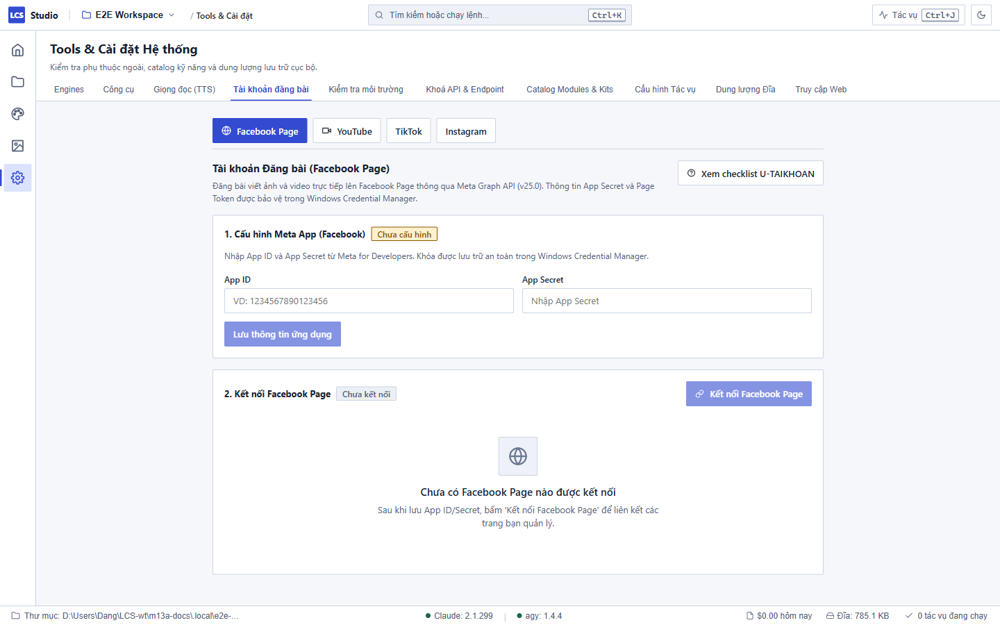

# Kết nối và Đăng bài lên Facebook Page — Local Content Studio

Local Content Studio hỗ trợ tự động hoá quy trình chuẩn bị và đăng bài viết (kèm hình ảnh hoặc video) lên các Facebook Page mà bạn quản trị thông qua giao tiếp bảo mật với Meta Graph API.

Mọi khoá xác thực và mã phiên đều được lưu trữ trực tiếp trong **Windows Credential Manager** trên máy tính cá nhân của bạn, tuyệt đối không gửi tới bất kỳ dịch vụ đám mây trung gian nào.

---

## 1. Tạo ứng dụng Meta trên Meta for Developers

Để có quyền kết nối vào Facebook Page của chính bạn, bạn cần tạo một ứng dụng nhà phát triển cá nhân (hoàn toàn miễn phí):

1. Truy cập trang web: <https://developers.facebook.com/> và đăng nhập bằng tài khoản Facebook sở hữu Page.
2. Bấm vào mục **Ứng dụng của tôi (My Apps)** → Chọn **Tạo ứng dụng (Create App)**.
3. Chọn loại trường hợp sử dụng (Use case): **Khác (Other)** → Chọn loại ứng dụng: **Doanh nghiệp (Business)**.
4. Đặt tên hiển thị cho ứng dụng (ví dụ: `Studio Ca Nhan`) và nhập email liên hệ của bạn → Bấm **Tạo ứng dụng**.
5. Trong bảng điều khiển ứng dụng, tìm mục **Đăng nhập bằng Facebook (Facebook Login)** → Bấm **Thiết lập (Set Up)**.
6. Địa chỉ nhận kết quả đăng nhập của Studio là:
     ```text
     http://localhost:8911/callback
     ```
   Meta bắt buộc HTTPS cho mọi URI chuyển hướng (ô **Thực thi HTTPS** bị khoá), trừ `localhost`: khi ứng dụng ở chế độ
   **Phát triển**, Meta tự cho phép địa chỉ `localhost` mà không cần thêm. Hãy giữ ứng dụng ở chế độ Phát triển. Đừng dùng
   `127.0.0.1` — Meta sẽ báo "Phải dùng HTTPS cho mọi URI chuyển hướng".
7. Vào mục **Cài đặt ứng dụng (App Settings) › Cơ bản (Basic)** ở cột menu bên trái:
   - Ghi lại chuỗi **ID ứng dụng (App ID)**.
   - Bấm nút "Hiển thị" tại dòng **Khoá bí mật của ứng dụng (App Secret)** và sao chép mã này.

---

## 2. Nạp App ID & Secret vào Studio



1. Mở Local Content Studio trên máy tính.
2. Nhấn **`Ctrl+5`** để mở **Tools & Cài đặt** → Chọn tab **Tài khoản đăng bài** (Accounts).
3. Tìm tới khu vực **Facebook Page**:
   - Nhập chuỗi **App ID** vừa sao chép ở Bước 1.
   - Nhập chuỗi **App Secret**.
4. Bấm **Lưu thông tin ứng dụng**. Studio sẽ lưu các khoá này an toàn vào hệ thống Windows Credential Manager của máy tính.

---

## 3. Kết nối Facebook Page của bạn

1. Trong tab **Tài khoản đăng bài**, bấm nút **Kết nối Facebook Page**.
2. Trình duyệt web mặc định trên máy tính của bạn sẽ tự động mở trang xác thực của Facebook:
   - Đăng nhập vào tài khoản Facebook cá nhân quản trị Page (nếu chưa đăng nhập).
   - Màn hình phân quyền hiện ra: tích chọn các Trang (Page) bạn muốn cấp quyền cho Studio quản lý.
   - Bấm **Tiếp tục / Cho phép** để cấp các quyền tiêu chuẩn (`pages_show_list`, `pages_manage_posts`, `pages_read_engagement`, `business_management`).
3. Sau khi xác nhận trên trình duyệt, trang web sẽ hiển thị thông báo kết nối thành công và tự động đóng.
4. Quay trở lại Studio:
   - Ứng dụng đã tự động tiếp nhận mã và đổi sang mã truy cập dài hạn của Page (**Long-lived Page Access Token**). Token này không có hạn sử dụng và không yêu cầu đăng nhập lại thường xuyên.
   - Danh sách Page đã kết nối sẽ hiển thị rõ ràng trên màn hình Cài đặt kèm theo tên trang và ID.

---

## 4. Quy trình đăng bài an toàn (Mặc định Không công khai)

Để bảo đảm an toàn và cho phép bạn kiểm duyệt kỹ lưỡng trước khi đưa nội dung tới khán giả:

1. Trong màn hình Dự án (`Ctrl+2`), mở bảng **Thành phẩm (Outputs)** (`Ctrl+Alt+B`).
2. Chọn ấn phẩm video MP4 hoặc ảnh bạn muốn đăng → Bấm nút **Đăng…** → Chọn nền tảng đích là **Facebook Page**.
3. Điền tiêu đề, bài viết nội dung (caption) và kiểm tra các hashtags đính kèm (hệ thống có bộ đếm ký tự trực quan).
4. **Nguyên tắc an toàn mặc định:**
   - Khi đăng bài, Studio luôn gửi tham số **`published=false`** (bản nháp / không công khai).
   - Bài viết sau khi tải lên sẽ không xuất hiện ngay trên Bảng tin công khai của người theo dõi trang.
   - Bạn chỉ cần mở **Meta Business Suite** (hoặc Studio Sáng tạo / Creator Studio) của Page để xem lại bản nháp, chỉnh sửa thêm hiệu ứng nếu thích, rồi bấm nút Đăng chính thức.

---

## 5. Dùng "Gói xuất thư mục" khi chưa kết nối Facebook API

Nếu bạn chưa muốn tạo Meta App hoặc chỉ muốn đăng thủ công mà không cần cấu hình API:

1. Trong hộp thoại Đăng bài, nếu tài khoản Facebook chưa được kết nối, Studio sẽ tự động chuyển sang chế độ: **Gói xuất thư mục (Publish Package)**.
2. Bấm nút **Tạo gói xuất**:
   - Hệ thống tự động tập hợp tệp video hoặc ảnh chất lượng cao nhất, tệp phụ đề rời (`.srt`), và một tệp văn bản tóm tắt chứa sẵn tiêu đề, nội dung caption và hashtags vào thư mục:
     `projects/<slug>/publish/<id>/`
3. Bấm **Mở thư mục**: Cửa sổ File Explorer sẽ hiện ra. Bạn chỉ việc kéo tệp video vào trình duyệt Facebook thông thường, dán nội dung chữ đã được chuẩn bị sẵn và xuất bản.

---

## 6. Xử lý khi gặp sự cố

| Bạn thấy | Nguyên nhân | Cách khắc phục |
| :--- | :--- | :--- |
| Trình duyệt báo `redirect_uri_mismatch` hoặc "URL bị chặn" | Chưa thêm đúng địa chỉ callback trong phần cài đặt của Meta App | Mở trang Meta for Developers › Facebook Login › Settings, kiểm tra ứng dụng còn ở chế độ **Phát triển** (Meta chỉ tự cho phép `http://localhost:8911/callback` ở chế độ này) và bạn là quản trị viên của ứng dụng. |
| Bấm kết nối nhưng trình duyệt không mở | Cổng loopback 8911 trên máy đang bị một ứng dụng khác chiếm dụng | Khởi động lại Studio hoặc kiểm tra xem có tiến trình nào khác đang mở cổng 8911. |
| Danh sách Page trống sau khi hoàn tất đăng nhập | Tài khoản Facebook của bạn chưa sở hữu hoặc chưa được phân quyền quản trị viên trên bất kỳ Trang nào | Đảm bảo tài khoản đăng nhập có vai trò Quản trị viên (Admin) hoặc Biên tập viên (Editor) trên Facebook Page bạn muốn đăng bài. |
| Đăng video dung lượng lớn bị gián đoạn giữa chừng | Mạng Internet gia đình bị chập chờn | Studio sử dụng cơ chế tải lên phân đoạn (Resumable Chunked Upload). Bạn có thể bấm Thử lại để tiếp tục tải lên các phân đoạn còn lại mà không cần tải lại từ đầu. |
| Muốn đổi sang quản trị Page khác | Cần cấp lại danh sách Page được chọn | Bấm **Ngắt kết nối** trong tab Cài đặt, sau đó bấm Kết nối lại và chọn lại danh sách Page trên giao diện của Meta. |
