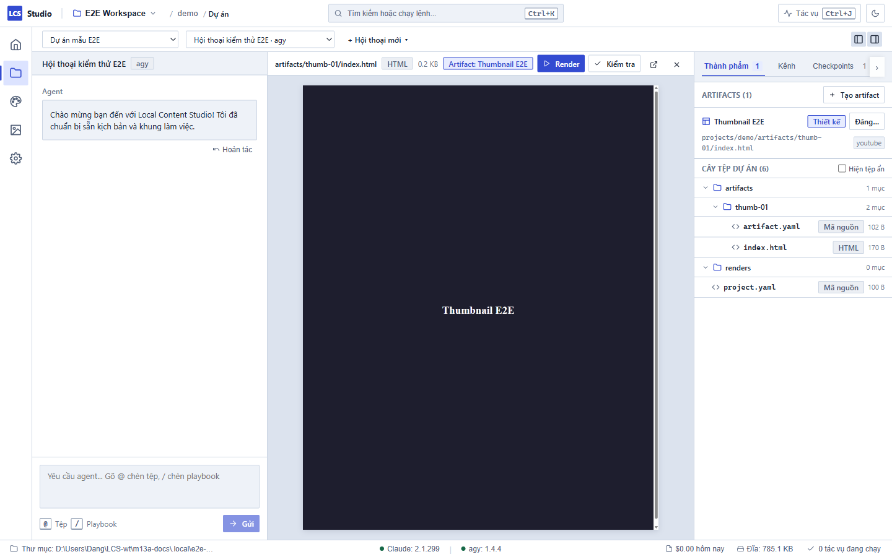
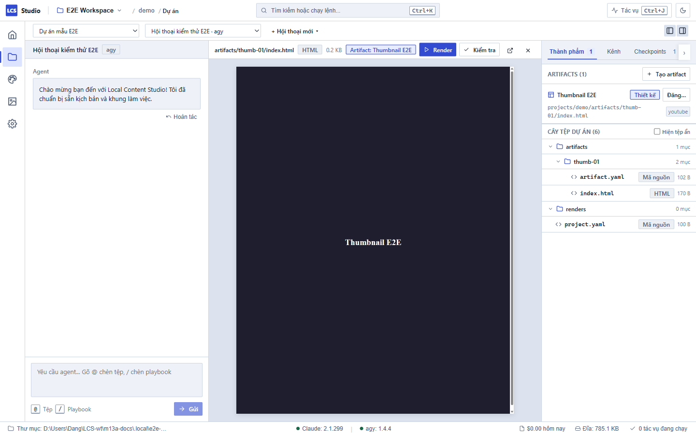

# Kiểm tra Tiêu chuẩn Kênh — Local Content Studio

Tính năng **Ma trận Kênh (Channel Matrix)** trong bảng Thành phẩm (Outputs) giúp bạn kiểm soát chất lượng nội dung trước khi xuất bản, bảo đảm từng ấn phẩm truyền thông (video, ảnh thumbnail, poster) đều tuân thủ chặt chẽ yêu cầu kỹ thuật của từng nền tảng mạng xã hội.

---

## 1. Mở Ma trận Kênh trong Outputs

1. Nhấn **`Ctrl+2`** để vào không gian **Dự án (Projects)**.
2. Nếu bảng thành phẩm bên phải đang ẩn, nhấn **`Ctrl+Alt+B`** để mở khung **Outputs**.
3. Trong khung Outputs, chọn tab **Kênh** (bên cạnh các tab Thành phẩm và Checkpoint).
4. Bạn sẽ thấy một bảng ma trận cô đọng:
   - **Mỗi hàng:** Đại diện cho một Artifact (tài sản nội dung, ví dụ: video MP4, ảnh bìa thumbnail HTML/PNG).
   - **Mỗi cột:** Đại diện cho một Kênh phát hành liên quan (được viết tắt như **YT** - YouTube, **TT** - TikTok, **FB** - Facebook, **IG** - Instagram). Rê chuột lên tiêu đề cột để xem tên đầy đủ của kênh.

---

## 2. Ý nghĩa các ký hiệu trạng thái trên ô ma trận

Tại mỗi giao điểm giữa ấn phẩm và kênh, hệ thống hiển thị một biểu tượng trạng thái trực quan:

| Ký hiệu | Màu sắc | Trạng thái | Ý nghĩa |
| :---: | :---: | :--- | :--- |
| **`✓`** | Xanh lá | **Đạt tiêu chuẩn** | Ấn phẩm đáp ứng hoàn hảo mọi quy chuẩn về kích thước, bảng màu, thời lượng và vùng an toàn của kênh. |
| **`⚠`** | Vàng | **Cảnh báo** | Có một số tiêu chí chưa tối ưu (ví dụ: độ tương phản màu hơi thấp, phụ đề gần sát mép), nhưng vẫn có thể xuất bản được. |
| **`✗`** | Đỏ | **Không đạt (Lỗi)** | Vi phạm các quy chuẩn bắt buộc của nền tảng (ví dụ: sai độ phân giải, thiếu phụ đề, thiếu logo thương hiệu). Cần sửa trước khi đăng. |
| **`—`** | Xám | **Chưa render** | Ấn phẩm mới chỉ có mã nguồn thiết kế hoặc kịch bản, chưa được xuất bản ra tệp hình ảnh/video thực tế để kiểm tra. |

---

## 3. Xem chi tiết lỗi và "Nhờ agent sửa"

Khi phát hiện một ô có dấu **`✗`** hoặc **`⚠`**:

1. **Bấm chuột vào ô đó:** Một hộp thoại chi tiết (Popover) sẽ mở ra ngay tại vị trí bấm.
2. Trong hộp thoại, bạn sẽ thấy:
   - Tên ấn phẩm và kênh phát hành đang kiểm tra.
   - Danh sách chi tiết từng lỗi hoặc cảnh báo bằng tiếng Việt rõ ràng, kèm vị trí vi phạm và gợi ý cách khắc phục.
3. **Các nút thao tác:**
   - **Render ngay** *(nếu ô chưa render)*: Kích hoạt tác vụ xuất file cho artifact.
   - **Kiểm tra lại:** Chạy lại công cụ kiểm tra tiêu chuẩn sau khi bạn tự sửa tệp.
   - **Nhờ agent sửa:** Bấm vào nút này để hệ thống tự động tổng hợp toàn bộ danh sách lỗi, đường dẫn tệp và điền trực tiếp vào khung soạn thảo tin nhắn (composer) của luồng chat AI.
4. **Gửi yêu cầu cho Agent:** Sau khi nội dung prompt được điền vào ô chat, hệ thống **không tự ý gửi ngay** mà để bạn kiểm tra lại nội dung, bổ sung dặn dò nếu muốn, rồi nhấn **Enter** để agent bắt đầu sửa lỗi.

---

## 4. Bảng tra cứu ý nghĩa các mã lỗi kiểm tra kênh

Dưới đây là danh sách các lỗi kiểm chuẩn phổ biến trong Studio và hướng xử lý:

| Mã lỗi hệ thống | Tên hiển thị tiếng Việt | Nguyên nhân & Cách khắc phục |
| :--- | :--- | :--- |
| `DIMENSIONS_MISMATCH` | **Sai kích thước định dạng** | Kích thước ảnh hoặc video không khớp với định dạng kênh (ví dụ: render ra 1280×720 nhưng kênh yêu cầu 1920×1080). Hãy sửa lại thuộc tính width/height trong tệp nguồn hoặc yêu cầu agent điều chỉnh. |
| `NO_RENDERS` | **Chưa có bản render** | Artifact chưa được kết xuất thành file nhị phân (PNG, MP4). Bấm nút **Render ngay** để xuất file. |
| `DURATION_TOO_SHORT` | **Thời lượng video quá ngắn** | Video chưa đạt độ dài tối thiểu kênh quy định. Cần kéo dài cảnh quay hoặc tăng nội dung phân cảnh. |
| `DURATION_EXCEEDED` | **Thời lượng video vượt quá giới hạn** | Video dài hơn mức trần của định dạng (ví dụ: Shorts/Reels vượt quá 60s). Cần cắt bớt các đoạn thừa. |
| `CAPTIONS_MISSING` | **Thiếu phụ đề bắt buộc** | Kênh yêu cầu có phụ đề trên màn hình nhưng video chưa được gắn track phụ đề (`subtitles`). |
| `BRAND_CONTRAST_LOW` | **Độ tương phản màu thấp** | Tỉ lệ tương phản giữa màu chữ và màu nền quá thấp, gây khó đọc cho người xem. Hãy đổi màu chữ hoặc làm tối màu nền. |
| `LOGO_MISSING` | **Thiếu logo thương hiệu** | Video hoặc ấn phẩm thiết kế chưa có logo của thương hiệu theo quy chuẩn. Cần thêm lớp phủ logo (overlay) ở góc màn hình. |
| `PALETTE_MISMATCH` | **Sai bảng màu thương hiệu** | Sử dụng các mã màu nằm ngoài bảng màu quy định của Brand. |
| `SAFE_ZONE_VIOLATION` | **Vi phạm vùng an toàn (Safe Zone)** | Nội dung quan trọng hoặc phụ đề bị đặt lấn vào khu vực các nút bấm, thanh điều hướng của mạng xã hội (TikTok, Shorts). |
| `SAFE_ZONE_TOP_VIOLATION` | **Vi phạm vùng an toàn trên** | Chi tiết thiết kế đặt quá sát mép trên màn hình. |
| `SAFE_ZONE_BOTTOM_VIOLATION` | **Vi phạm vùng an toàn dưới** | Phụ đề hoặc văn bản đặt quá sát mép dưới, dễ bị tiêu đề video che mất. |
| `TEXT_LIMIT_EXCEEDED` | **Vượt giới hạn ký tự** | Tiêu đề hoặc phần mô tả dài hơn số ký tự tối đa nền tảng cho phép. |
| `VOICE_WORD_DISALLOWED` | **Chứa từ ngữ thương hiệu cấm dùng** | Kịch bản hoặc giọng đọc vi phạm danh sách từ cấm kỵ được cài đặt trong cấu hình Brand. |
| `BRAND_NOT_FOUND` | **Không tìm thấy cấu hình thương hiệu** | Artifact tham chiếu tới một ID thương hiệu không tồn tại trong workspace hoặc tầng App. |

---

## 5. Cơ chế lưu đệm thông minh (Cache)

- Kết quả kiểm tra được lưu tự động trong cơ sở dữ liệu SQLite của Workspace dựa trên mã băm nội dung render (`render_hash`) và phiên bản kênh (`channel_version`).
- Nếu bạn không thay đổi file hoặc cấu hình kênh, Studio sẽ lấy ngay kết quả từ bộ nhớ đệm mà không làm tốn tài nguyên máy tính.
- Ma trận sẽ **tự động làm mới** ngay khi một tác vụ render hoàn tất thành công (`job-event succeeded`) hoặc khi bạn lưu lại chỉnh sửa trong cấu hình kênh.
