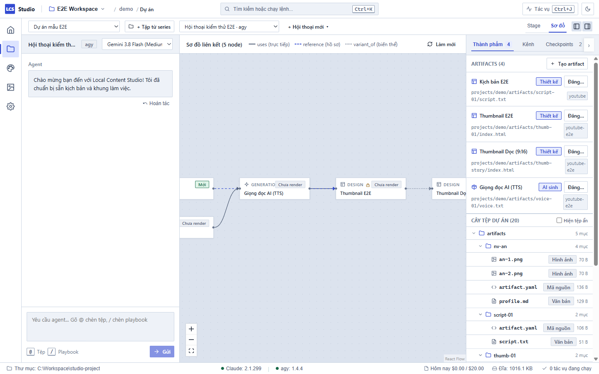
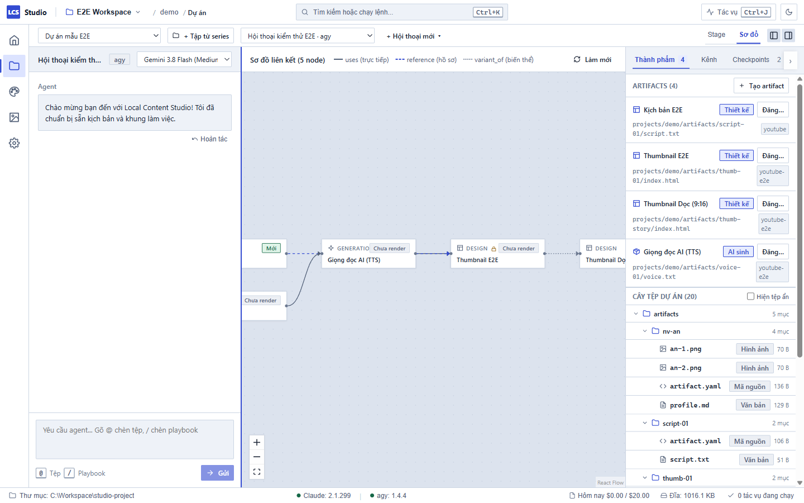
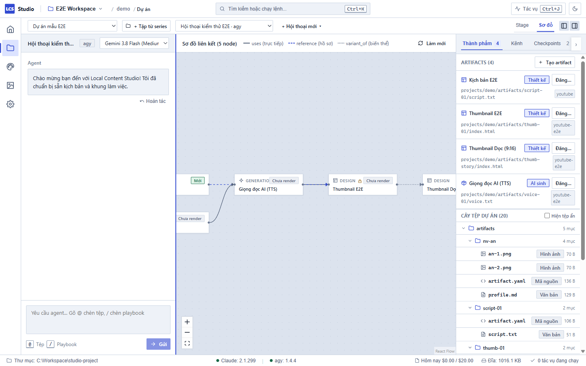
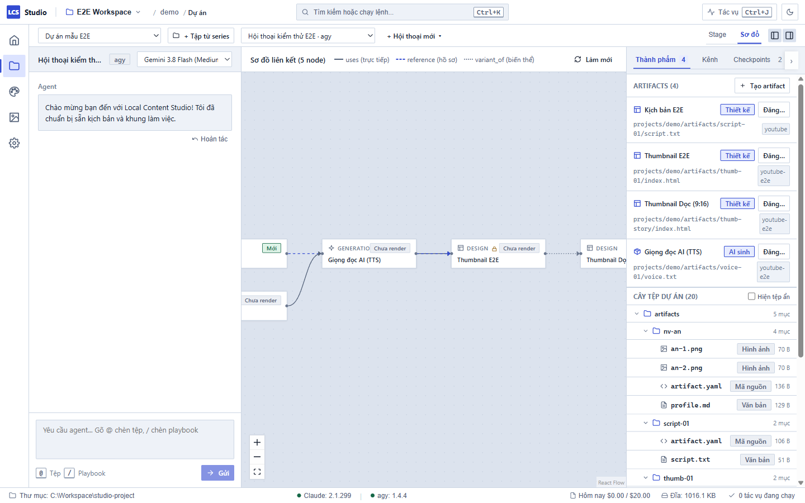
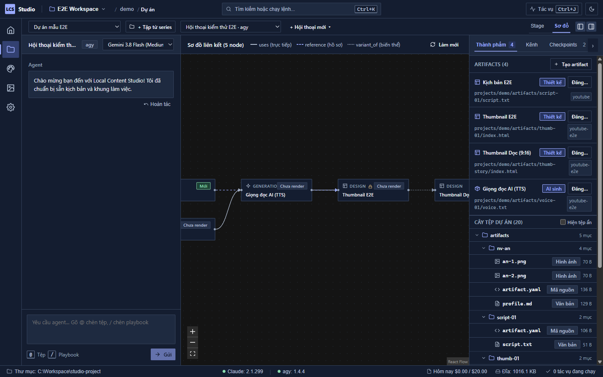

# Quản lý Sơ đồ Nội dung & Series — Local Content Studio

Tab **Sơ đồ** trong màn hình Dự án (`Ctrl+2`) cung cấp cái nhìn trực quan toàn diện về mạng lưới các ấn phẩm (artifacts) trong dự án của bạn: mối quan hệ phụ thuộc lẫn nhau, trạng thái cập nhật hay lỗi thời ("cũ"), cơ chế khóa an toàn, hồ sơ tham chiếu nhất quán và quy trình sản xuất phim theo Series nhiều tập.

---

## 1. Các Node & Cạnh Phụ Thuộc (Nodes & Edges)

Trong tab Sơ đồ, mỗi ấn phẩm nội dung được biểu diễn bằng một thẻ **Node**, và mối quan hệ giữa chúng được nối kết qua các đường **Cạnh (Edges)** có định hướng.

### Ý nghĩa của các loại Cạnh (Roles)

Hệ thống phân định rõ ràng 3 kiểu liên kết phụ thuộc với kiểu đường nét trực quan:

| Kiểu liên kết | Định dạng đường | Cơ chế lan truyền lỗi thời | Mục đích sử dụng |
| :--- | :--- | :--- | :--- |
| `uses` | Nét liền | **Có** (đổi mã băm render) | Phụ thuộc trực tiếp: Node đích sử dụng trực tiếp tệp nguồn của Node gốc (ví dụ: Timeline dùng tệp âm thanh giọng đọc và hình ảnh B-roll). |
| `reference` | Nét đứt | **Không** (không làm cũ node con) | Tham chiếu phong cách / nhân vật: Cung cấp ảnh mẫu, giọng nói chuẩn hoặc hồ sơ ngữ cảnh cho AI khi sáng tạo, không làm phát sinh yêu cầu kết xuất lại. |
| `variant_of` | Nét chấm chấm | **Có** (khi bản gốc đổi) | Biến thể định dạng: Ấn phẩm phái sinh từ bản gốc (ví dụ: Video ngắn dọc 9:16 biến thể từ video ngang 16:9). |

### Trạng thái của Node & Nhận diện Ấn phẩm "Cũ" (Stale)

Mỗi node hiển thị nhãn phân loại (Kịch bản, Thiết kế, Âm thanh, Timeline, Video, Hồ sơ) và huy hiệu trạng thái:
- **Mới / Sẵn sàng (Xanh lục):** Nội dung và bản render trên đĩa hoàn toàn khớp với dữ liệu đầu vào hiện tại.
- **Cũ / Lỗi thời (Vàng cam):** Khi một node đầu vào (input) thay đổi nội dung, mã băm đầu vào (`render_cache_key`) hiện tại không còn khớp với bản kết xuất gần nhất. Trạng thái "Cũ" sẽ tự động lan truyền xuôi dòng dọc theo các cạnh `uses` và `variant_of`.
- **Chưa render (Xám):** Ấn phẩm mới tạo cấu hình nhưng chưa được kết xuất ra tệp thành phẩm.

### Cách Render lại Node

Khi một node bị cũ hoặc cần dựng lại:
1. **Render trực tiếp:** Nhấp chuột phải vào node → chọn **Render lại**.
2. **Xem và duyệt trên Stage:** Nhấp đúp vào node (hoặc chọn *Mở trên Stage* trong menu chuột phải) để chuyển sang tab Stage xem chi tiết, sau đó nhấn nút **Render** trên thanh công cụ.
3. **Cập nhật toàn bộ xuôi dòng:** Chọn *Cập nhật phía dưới* để dựng lại đồng loạt mọi node liên quan.

---

## 2. Khóa Node (`pinned: true`)

Khi bạn đã hoàn toàn ưng ý với một ấn phẩm (ví dụ: kịch bản đã được phê duyệt, hoặc một ảnh bìa thumbnail đã ưng ý) và muốn đóng băng để tránh bị AI hoặc các lệnh tự động sửa đổi ngoài ý muốn, hãy sử dụng tính năng **Khóa node**.

### Cơ chế bảo vệ của Node Khóa

1. **Thao tác nhanh:** Nhấp chuột phải vào node → chọn **Khóa node (pinned)**. Thẻ node sẽ xuất hiện biểu tượng ổ khóa màu vàng cam và viền bảo vệ.
2. **Chặn công cụ ngoài & AI:** Khi một node đang khóa, máy chủ Studio MCP từ chối thẳng thừng mọi yêu cầu `artifact_render` hoặc tiến trình AI cố ghi đè vào thư mục của artifact đó với thông báo tiếng Việt:
   > *"Artifact {id} đang khoá — mở khoá trong tab Sơ đồ trước khi render/gen lại."*
3. **Tự động bỏ qua khi cập nhật xuôi dòng:** Tiến trình cập nhật tự động sẽ không bao giờ chạm vào node đã khóa.
4. **Cảnh báo và Hoàn tác sau lượt chat:** Nếu trong một lượt trò chuyện, AI cố tình can thiệp vào các tệp thuộc node bị khóa, hệ thống sẽ phát hiện ngay khi kết thúc lượt và hiển thị cảnh báo trên khung Thread kèm nút **Hoàn tác phần này** để khôi phục nguyên trạng tệp tin của node đó từ checkpoint an toàn.
5. **Mở khóa:** Nhấp chuột phải vào node → chọn **Mở khóa node**.

---

## 3. Kéo Nối Cạnh Khai Báo Input & Duyệt Chi Phí Cập Nhật

Bạn có thể chỉnh sửa trực tiếp sơ đồ quan hệ bằng thao tác trực quan ngay trên canvas.

### Thao tác Kéo Nối Cạnh
1. Rê chuột vào chấm tròn (handle) ở cạnh phải của node nguồn.
2. Kéo đường nối sang chấm tròn ở cạnh trái của node đích rồi thả chuột.
3. Hộp thoại **Chọn vai trò liên kết** (`RolePickerDialog`) sẽ xuất hiện: chọn giữa `uses`, `reference`, hoặc `variant_of`.
4. Hệ thống tự động kiểm tra chu trình: nếu liên kết mới tạo thành vòng lặp vô hạn (chu trình A → B → C → A), hệ thống sẽ từ chối và cảnh báo bằng tiếng Việt.
5. Mọi thao tác nối cạnh hoặc xóa cạnh (chọn cạnh rồi nhấn phím `Delete` hoặc `Backspace`) đều tự động lưu vào tệp `artifact.yaml` và tạo một điểm khôi phục Checkpoint CAS an toàn.

### Cập nhật Phía Dưới & Hộp Thoại Duyệt Chi Phí

Khi bạn thay đổi nội dung ở một mắt xích đầu nguồn (ví dụ: sửa kịch bản), bạn có thể chạy cập nhật dây chuyền:
- Nhấp chuột phải vào node gốc → chọn **Cập nhật phía dưới**.
- Studio phân tích thứ tự topo của đồ thị và mở hộp thoại kế hoạch cập nhật:

- **Các bước miễn phí:** Render HTML sang ảnh, hiệu ứng HyperFrames, và dựng timeline bằng FFmpeg chạy hoàn toàn ngoại tuyến trên máy bạn.
- **Các bước tốn phí (`paid`):** Các tác vụ gọi AI đám mây (sinh ảnh DALL-E/Flux, sinh video) được tách riêng cùng **ước tính chi phí USD** cụ thể. Hệ thống chỉ thực thi khi bạn bấm nút **Xác nhận & Cập nhật**.
- Các node đang bị khóa (`pinned`) sẽ được liệt kê trong danh sách bỏ qua an toàn.

---

## 4. Hồ Sơ Tham Chiếu Nhất Quán (`kind: reference`)

Để một chuỗi video hoặc các ấn phẩm có sự đồng nhất về phong cách mỹ thuật và nhân vật, Studio cung cấp loại ấn phẩm đặc biệt: **Hồ sơ tham chiếu (Reference Profile)**.

### Cấu trúc Hồ sơ Tham chiếu
Hồ sơ được lưu trữ dưới dạng một artifact có `kind: reference`:
- Tệp `profile.md`: Mô tả chi tiết diện mạo nhân vật, đặc điểm trang phục, tông màu ánh sáng hoặc tính cách giọng đọc.
- Các tệp ảnh mẫu (`params.images`): Ví dụ `an-1.webp`, `an-2.webp` chụp chân dung chuẩn ở nhiều góc nhìn.
- Hạt giống ngẫu nhiên cố định (`params.seed`): Đảm bảo các lượt sinh ảnh AI giữ được nét mặt nhân vật xuyên suốt.

### Menu "Đặt làm hồ sơ" & "Gắn hồ sơ…"
- **Đặt làm hồ sơ:** Nhấp chuột phải vào bất kỳ artifact hoặc hình ảnh mẫu nào trên sơ đồ → chọn **Đặt làm hồ sơ**. Hệ thống sẽ chuyển đổi thành node tham chiếu và đưa về cột mốc chuẩn mực ở mép trái sơ đồ.
- **Gắn hồ sơ…:** Nhấp chuột phải vào một node cần tạo hình ảnh/video → chọn **Gắn hồ sơ…**. Chọn hồ sơ nhân vật tương ứng từ danh sách để thiết lập cạnh nối kiểu `reference`. Khi AI sinh ảnh cho node này, hệ thống sẽ tự động truyền ảnh mẫu và seed vào câu lệnh.

---

## 5. Quản lý Series & Bộ Kiểm Tra Nhất Quán (`SERIES_*`)

Studio hỗ trợ sản xuất nội dung theo dạng **Series nhiều tập** (ví dụ: chuỗi bài học, chuỗi phóng sự ngắn, phim hoạt hình nhiều tập) với cấu hình dùng chung đặt tại `series/<slug>/series.yaml`.

### Tạo Series & Tạo Tập Mới
1. **Khai báo Series:** Định nghĩa công thức sản xuất chung (Bộ kit, Playbook quy trình) và danh sách hồ sơ nhân vật dùng chung.
2. **Tạo tập mới:** Bấm nút **Tạo tập mới từ series** trên thanh tiêu đề Dự án. Hệ thống tự động tạo thư mục dự án tập mới, kế thừa bộ quy trình chuẩn và tự động móc nối cạnh `reference` tới các hồ sơ tham chiếu của Series.

### Bộ Kiểm Tra Tiêu Chuẩn Series (Consistency Checkers)

Khi các ấn phẩm trong tập phim được kiểm định qua Ma trận Kênh, hệ thống kích hoạt bộ kiểm tra đối chiếu chéo giữa các tập trong cùng một Series:

| Mã kiểm định | Tên hiển thị tiếng Việt | Nguyên nhân & Cách khắc phục |
| :--- | :--- | :--- |
| `SERIES_INTRO_MISMATCH` | Khác clip mở đầu (intro) so với các tập cùng series | Clip đầu tiên trên timeline của tập này không cùng nguồn tư liệu với các tập khác trong series. |
| `SERIES_OUTRO_MISMATCH` | Khác clip kết thúc (outro) so với các tập cùng series | Clip kết thúc video khác biệt so với quy chuẩn chung của series. |
| `SERIES_FONT_MISMATCH` | Khác font tiêu đề thumbnail so với các tập cùng series | Phông chữ thiết kế trên ảnh bìa thumbnail không đồng nhất với các tập trước. |
| `SERIES_VOICE_MISMATCH` | Khác giọng đọc TTS so với các tập cùng series | Giọng đọc AI sử dụng khác mô hình hoặc người đọc đã chọn cho series. |
| `SERIES_REFERENCE_MISSING` | Chưa gắn hồ sơ tham chiếu của series | Tập phim chưa thiết lập cạnh nối kiểu `reference` tới hồ sơ nhân vật của series. Bấm chuột phải vào node và chọn *Gắn hồ sơ…* để liên kết. |

---

## 6. Giao Diện Sáng / Tối (Light & Dark Theme)

Toàn bộ canvas Sơ đồ nội dung được xây dựng trên hệ thống biến màu giao diện chuẩn Design System:
- Nền canvas (`--cs-bg-canvas`), lưới tọa độ (`--cs-canvas-grid`) và màu sắc đường viền các node tự động biến chuyển tương phản sắc nét.
- Bạn có thể chuyển đổi chế độ giao diện tức thì bằng phím tắt **`Ctrl+J`** hoặc nhấn biểu tượng mặt trời / mặt trăng trên thanh công cụ góc phải màn hình.

---

## Phím Tắt Tiện Ích trong Tab Sơ đồ

- **Cuộn chuột:** Thu phóng phóng to / thu nhỏ canvas (`zoom in / out`).
- **Giữ chuột trái trên nền trống:** Kéo rê canvas (`pan`).
- **Nhấp chuột vào node:** Chọn node (giữ `Shift` để chọn nhiều node).
- **Nhấn "Gửi cho agent":** Chèn nhanh danh sách các node đang chọn dạng `@<id>` vào ô chat của Thread để yêu cầu AI chỉnh sửa hoặc phân tích.
- **Phím `Delete` hoặc `Backspace`:** Xóa cạnh liên kết đang chọn.
