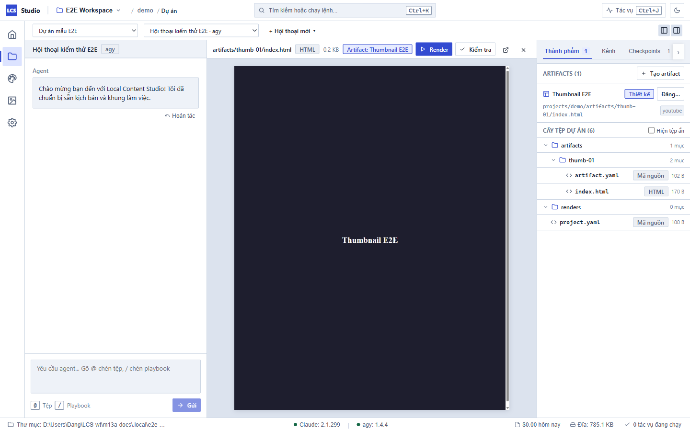
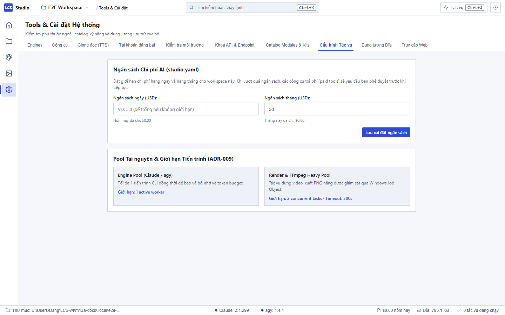

# Quản lý Hội thoại và Kiểm soát Ngân sách — Local Content Studio

Trong Local Content Studio, luồng trò chuyện với AI Agent (Claude Code CLI, agy) được thiết kế giống như một môi trường phát triển chuyên nghiệp: bạn hoàn toàn làm chủ từng lượt trao đổi, dễ dàng khắc phục khi agent làm sai, và luôn kiểm soát chặt chẽ ngân sách chi tiêu từng ngày.

---

## 1. Thử lại một lượt hội thoại bị lỗi (Retry Turn)

Trong quá trình làm việc, một lượt tương tác của agent có thể gặp sự cố (mất kết nối mạng, hết quota tạm thời, lỗi tiến trình CLI, hoặc câu lệnh không hoàn tất):

1. **Nhận biết trên màn hình:** Khung tin nhắn của agent sẽ chuyển sang viền màu đỏ kèm biểu tượng cảnh báo và thông tin chi tiết lỗi (Callout báo lỗi).
2. **Nút Thử lại:** Ở góc phải của khung báo lỗi có nút **Thử lại**.
3. **Thao tác:** Nhấp chuột vào nút **Thử lại**:
   - Studio sẽ tự động gửi lại đúng nội dung yêu cầu (prompt) ban đầu của bạn với cùng cấu hình engine và model.
   - Lượt lỗi trước đó vẫn được lưu giữ trong lịch sử hội thoại để bạn dễ dàng đối chiếu nguyên nhân.

---

## 2. Sửa và gửi lại tin nhắn gần nhất (Edit & Resend)

Nếu bạn vừa gửi một yêu cầu nhưng nhận ra mình mô tả chưa rõ, hoặc muốn đổi ý trước khi tiếp tục:

1. Rê chuột lên **tin nhắn người dùng cuối cùng** trong khung hội thoại.
2. Bạn sẽ thấy nút **Sửa** xuất hiện bên cạnh tin nhắn (nút này chỉ hiển thị khi không có tác vụ nào đang chạy).
3. Bấm nút **Sửa**:
   - **Trường hợp lượt trước chưa sửa tệp:** Nội dung câu lệnh cũ sẽ được đưa ngay vào ô soạn thảo (composer) ở đáy màn hình để bạn chỉnh sửa.
   - **Trường hợp agent đã sửa tệp trong dự án:** Hộp thoại xác nhận **Sửa và gửi lại tin nhắn?** sẽ hiện lên. Hộp thoại thông báo rõ: *"Hành động này sẽ hoàn tác toàn bộ thay đổi tệp mà agent đã thực hiện ở lượt này để đảm bảo mã nguồn và tài sản dự án trở về trạng thái sạch sẽ trước khi gửi lại"*.
4. Bấm **Hoàn tác & Sửa**: Hệ thống tự động khôi phục các tệp về trạng thái trước đó, đồng thời đưa văn bản vào ô nhập. Bạn chỉnh sửa lại câu lệnh và nhấn **Gửi**.

---

## 3. Đổi mô hình AI (Model) ngay giữa luồng hội thoại

Bạn không cần phải tạo một thread mới khi muốn chuyển từ model nhẹ sang model mạnh hơn:

1. Nhìn lên thanh tiêu đề ở đầu khung hội thoại (Thread Header).
2. Bạn sẽ thấy một menu chọn danh sách **Mô hình (Model Selector)** (ví dụ: `claude-3-7-sonnet`, `claude-3-5-haiku`, `gemini-2.0-flash`...).
3. Bấm vào menu và chọn mô hình mới:
   - Thay đổi này được lưu tức thì vào cơ sở dữ liệu của thread.
   - Các lượt gửi tiếp theo trong thread sẽ tự động kế thừa mô hình mới.
4. **Kiểm tra mô hình đã chạy:** Ở chân mỗi tin nhắn phản hồi của agent, mục tóm tắt chi phí (**Usage**) luôn hiển thị rõ tên mô hình cụ thể cùng thời gian và số token đã sử dụng.

---

## 4. Hoàn tác trạng thái dự án (Checkpoint Undo)

Studio tự động ghi nhận các điểm kiểm tra an toàn (CAS Checkpoint) trước và sau mỗi lượt agent can thiệp vào tệp tin:

1. Nếu kết quả sinh ra của agent không như ý muốn, bạn có thể:
   - Bấm nút **Hoàn tác** ở phần chân trang của tin nhắn agent.
   - Hoặc nhấn **`Ctrl+K`** gõ tìm lệnh: **`Hoàn tác lượt agent gần nhất...`**.
2. Một hộp thoại xác nhận an toàn sẽ hiện ra, liệt kê các tệp sẽ được khôi phục.
3. Bấm xác nhận để đưa toàn bộ tệp trong dự án trở lại đúng phiên bản trước lượt tương tác đó mà không lo mất dữ liệu.

---

## 5. Thiết lập Ngân sách Ngày và Tháng (Budget Control)

Để đảm bảo các công cụ trả phí (sinh ảnh AI, sinh video Veo, gọi mô hình lớn) không bao giờ tiêu lạm quỹ của bạn:

### Cài đặt hạn mức ngân sách

1. Nhấn **`Ctrl+5`** để mở **Tools & Cài đặt** → Chọn tab **Cấu hình tác vụ** (Jobs).
2. Tìm tới khu vực **Kiểm soát Ngân sách**:
   - **Ngân sách tối đa một ngày (USD):** Nhập số tiền giới hạn cho mỗi ngày (ví dụ: `5.00`).
   - **Ngân sách tối đa một tháng (USD):** Nhập số tiền giới hạn cho mỗi tháng (ví dụ: `50.00`).
3. Bấm **Lưu cấu hình**. Thông số này được lưu an toàn trong tệp `studio.yaml` của Workspace.

### Theo dõi trên Thanh trạng thái

- Ở thanh trạng thái dưới cùng của ứng dụng, bạn sẽ luôn thấy mục chỉ báo: **`$x / $y hôm nay`** (ví dụ: `$0.45 / $5.00 hôm nay`).
- Số liệu chi phí được tính toán trực tiếp từ sổ cái chi phí (`cost_ledger`) lưu cục bộ trong SQLite.
- Nhấp chuột trực tiếp vào dòng chi phí này để mở nhanh màn hình cài đặt ngân sách.

### Cơ chế bảo vệ tự động khi chạm trần ngân sách

- Khi chi phí trong ngày hoặc trong tháng đạt tới mức giới hạn đã đặt, hệ thống sẽ tự động gán ngân sách lượt về **`$0.00`**.
- Mọi công cụ AI có phí (như gọi API sinh ảnh hay video trả tiền) khi được agent gọi sẽ bị chặn lại và kích hoạt trạng thái **Chờ bạn duyệt (Needs Approval)** trên màn hình.
- Studio sẽ không bao giờ tự ý chi thêm tiền nếu chưa có sự đồng ý bằng văn bản của bạn.

---

## 6. Xử lý khi gặp sự cố

| Hiện tượng | Nguyên nhân | Cách khắc phục |
| :--- | :--- | :--- |
| Nút "Sửa" không xuất hiện trên tin nhắn của bạn | Tin nhắn đó không phải là tin cuối cùng trong thread, hoặc hiện đang có một tác vụ AI đang chạy | Chờ agent chạy xong lượt hiện tại; nếu muốn sửa tin cũ hơn, hãy dùng cơ chế hoàn tác từng lượt trong tab Checkpoint ở bảng Outputs. |
| Chi phí hôm nay chưa hiển thị trên thanh trạng thái | Chưa có tác vụ nào phát sinh chi phí hoặc chưa cấu hình ngân sách ngày trong `studio.yaml` | Vào **Cài đặt › Cấu hình tác vụ** nhập định mức ngày (ví dụ `5`) để bật chỉ báo. |
| Agent dừng lại và hỏi duyệt chi phí | Đã hết ngân sách ngày/tháng được cấp | Bạn có thể bấm Duyệt (Approve) cho lượt cụ thể đó, hoặc vào Cài đặt tăng hạn mức ngân sách ngày. |
