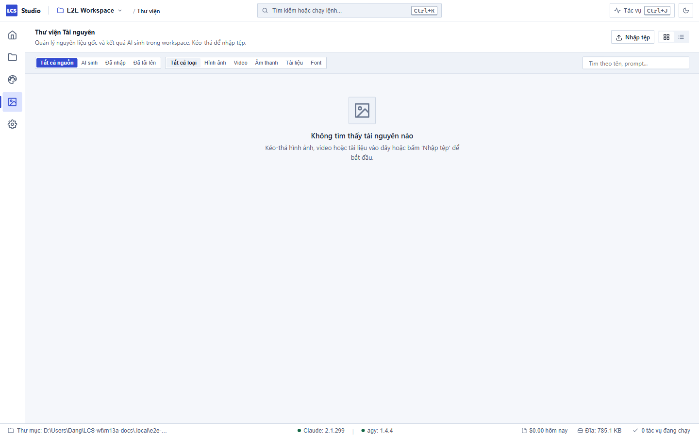

# Quản lý Thư viện Tài sản — Local Content Studio

Khu vực **Thư viện tài nguyên (Library)** (truy cập bằng phím tắt **`Ctrl+4`**) là kho lưu trữ tập trung toàn bộ nguyên liệu sáng tạo của bạn, từ hình ảnh, video, âm thanh do AI sinh ra cho đến các tài liệu, logo và tệp phông chữ được nhập từ máy tính.

---

## 1. Tìm kiếm và Lọc tài nguyên thông minh

Thư viện tự động gộp tài sản từ hai nguồn: thư mục dùng chung `library/` của Workspace và toàn bộ tài sản phát sinh trong từng dự án `projects/*/assets/**`.

Trên thanh công cụ của Thư viện, bạn có thể dễ dàng tìm lại mọi nguyên liệu thông qua các bộ lọc:

1. **Bộ lọc Loại tệp:** Chuyển đổi nhanh giữa:
   - **Tất cả:** Toàn bộ tệp tin.
   - **Hình ảnh:** PNG, JPG, JPEG, WebP, SVG, GIF...
   - **Video:** MP4, MOV, WebM, MKV...
   - **Âm thanh:** WAV, MP3, AAC, M4A, OGG...
   - **Tài liệu:** PDF, Markdown, TXT, SRT (phụ đề), JSON...
   - **Phông chữ:** TTF, OTF, WOFF, WOFF2...
2. **Bộ lọc Nguồn gốc:**
   - **Do AI sinh (`generated`):** Các ảnh, âm thanh hoặc video được tạo bởi agent qua API.
   - **Nhập từ máy tính (`imported`):** Tệp do bạn kéo thả hoặc nhập vào.
   - **Tải lên qua Web (`uploaded`):** Tệp tải lên từ điện thoại khi dùng chế độ Web cá nhân.
3. **Bộ lọc Dự án & Thương hiệu:** Giúp bạn nhanh chóng gom nhóm tài nguyên theo từng dự án hoặc từng Brand cụ thể.
4. **Ô tìm kiếm:** Nhập tên tệp để lọc tức thì.
5. **Chế độ hiển thị:** Bấm vào nút biểu tượng ở góc phải để đổi qua lại giữa dạng **Lưới ảnh (Grid)** hoặc dạng **Danh sách chi tiết (List)**.

---

## 2. Nhập tệp vào Thư viện (Kéo - Thả)

Bạn có thể đưa tài sản mới vào kho lưu trữ cực kỳ nhanh chóng:

1. Mở thư mục chứa tệp trên Windows File Explorer.
2. Chọn một hoặc nhiều tệp và **kéo trực tiếp vào vùng làm việc của Thư viện** trong Studio (vùng kéo thả sẽ sáng lên với thông báo *"Thả tệp vào đây để nhập vào thư viện"*).
3. Hoặc bấm nút **Nhập tệp** ở góc trên để chọn tệp từ cửa sổ duyệt file.
4. **Quy trình xử lý an toàn của Studio:**
   - Hệ thống tự động tạo một điểm kiểm tra (**CAS Checkpoint**) trước khi nạp tệp.
   - Các tệp được sao chép vào thư mục: `library/imports/<YYYY-MM-DD>/` (tệp gốc trên máy bạn vẫn được giữ nguyên vẹn).
   - Hệ thống tự động tạo ảnh thu nhỏ (thumbnail cache) kích thước tối đa 320×240 để hiển thị mượt mà mà không tốn RAM.
   - Một thông báo ngắn (Toast) sẽ hiện lên: *"Đã nhập X tệp vào thư viện"*.

---

## 3. Xem chi tiết, xem Prompt AI và Dùng trong Thread

Bấm chuột vào bất kỳ tệp tài sản nào để mở **Bảng chi tiết (Detail Drawer)** bên phải màn hình:

1. **Trình xem trước đa phương tiện:**
   - Xem ảnh phóng to sắc nét (hỗ trợ cả ảnh vector SVG).
   - Trình phát video chuyên dụng với thanh tua thời gian cho các tệp MP4, WebM.
   - Trình nghe nhạc và lời đọc trực tiếp cho các tệp WAV, MP3.
2. **Bản ghi Prompt và Chi phí AI (đối với tệp do AI sinh):**
   - Bạn sẽ thấy chính xác câu lệnh (**Prompt**) mà agent đã dùng để sinh ra bức ảnh/video này. Bấm nút **Chép prompt** để tái sử dụng câu lệnh.
   - Hiển thị rõ nhà cung cấp (**Provider**), tên mô hình (**Model**), mã lượt hội thoại (**Turn ID**) và chi phí ước tính (**Cost USD**) đã chi cho tài sản đó.
3. **Nút "Dùng trong thread":**
   - Bấm nút này, Studio sẽ tự động chuyển bạn sang màn hình Dự án (`Ctrl+2`), mở khung hội thoại và điền cú pháp `@đường-dẫn-tệp` vào ô soạn thảo tin nhắn. Bạn chỉ cần gõ thêm yêu cầu và nhấn gửi để agent tiếp tục xử lý tài sản đó.
4. **Nút "Mở thư mục":** Mở ngay vị trí tệp tin thực tế trong Windows Explorer.

---

## 4. Xoá tài sản và Hoàn tác an toàn

1. Trong bảng chi tiết của tệp, bấm nút **Xoá tệp**.
2. Một hộp thoại xác nhận hiện ra để tránh thao tác nhầm lẫn.
3. Khi bạn xác nhận xoá, Studio tạo ngay checkpoint và hiển thị thanh thông báo: *"Đã xoá tệp... — [Hoàn tác]"*.
4. Nếu bấm nhầm, bạn chỉ cần bấm nút **Hoàn tác** ngay trên thông báo, hoặc dùng tính năng hoàn tác checkpoint trong tab Checkpoints để khôi phục lại tệp ngay lập tức.

---

## 5. Quy chuẩn an toàn và Giới hạn tệp

Để bảo vệ máy tính và hệ thống không gian làm việc của bạn:

- **Giới hạn dung lượng:** Mỗi tệp nhập vào tối đa **200 MB**. Tệp lớn hơn ngưỡng này sẽ bị từ chối với thông báo rõ ràng.
- **Các loại tệp bị chặn tuyệt đối:** Các tệp thực thi hoặc tệp script có nguy cơ độc hại sẽ không được phép nhập:
  - `.exe`, `.bat`, `.cmd`, `.ps1`, `.vbs`, `.sh`, `.bin`, `.msi`, `.dll`, `.scr`, `.com`.
  - Các tệp nhị phân lạ không có phần mở rộng (ngoại trừ các file nén thông dụng như `.zip`, `.tar`, `.gz`).
- **Chặn đường dẫn mạng nguy hiểm:** Studio chặn hoàn toàn các đường dẫn mạng UNC (dạng `\\server\share...`) và các liên kết tắt (symlink, NTFS junction point) để đảm bảo không rò rỉ dữ liệu ngoài phạm vi workspace.

---

## 6. Xử lý khi gặp sự cố

| Hiện tượng | Nguyên nhân | Cách khắc phục |
| :--- | :--- | :--- |
| Kéo tệp vào nhưng Studio báo lỗi loại tệp không an toàn | Tệp có phần mở rộng nằm trong danh sách bị chặn (như file chạy `.exe` hoặc script `.bat`/`.ps1`) | Studio chỉ hỗ trợ tài nguyên truyền thông (hình ảnh, video, âm thanh, tài liệu, font chữ). Không kéo tệp chạy phần mềm vào thư viện. |
| Báo lỗi tệp vượt quá 200 MB | Kích thước video hoặc file tư liệu lớn hơn 200 MB | Nén giảm bớt bitrate video hoặc cắt ngắn phân đoạn trước khi nhập. |
| Không thấy ảnh do AI sinh trong Thư viện | Tệp mới sinh chưa kịp lập chỉ mục (index) | Bấm vào biểu tượng làm mới ở góc Thư viện, hoặc chuyển tab để hệ thống quét lại thư mục dự án. |
