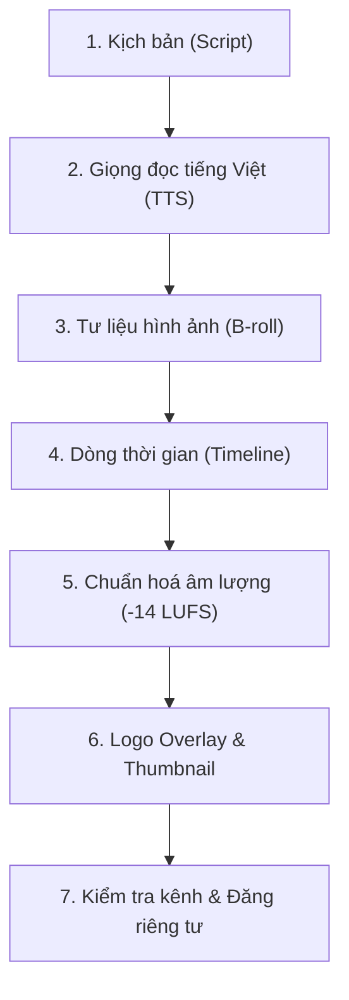

# Quy trình Sản xuất Video YouTube — Local Content Studio

Local Content Studio cho phép bạn kết hợp sức mạnh của AI Agent để tự động hóa trọn vẹn quy trình sản xuất một video YouTube chuẩn phát hành từ một câu lệnh duy nhất: từ viết kịch bản, đọc lời thoại tiếng Việt, dựng cảnh hình ảnh, ghép timeline, chuẩn hóa âm thanh, gắn logo thương hiệu, tạo ảnh bìa thumbnail cho đến xuất bản an toàn ở chế độ riêng tư.

> [!TIP]
> Trước khi xuất bản video lên kênh, hãy đảm bảo bạn đã kết nối tài khoản YouTube một lần theo hướng dẫn chi tiết tại: [Hướng dẫn kết nối YouTube](./ket-noi-youtube.md).

---

## Quy trình 7 bước sản xuất video với Agent

Bạn có thể bắt đầu ngay từ màn hình **Home** (`Ctrl+1`) hoặc trong một **Dự án** (`Ctrl+2`) bằng cách nhập yêu cầu vào ô chat:
> *"Làm video YouTube 60–90 giây giới thiệu về cách pha cà phê phin Việt Nam theo phong cách thương hiệu demo."*

Agent sẽ tuần tự triển khai 7 bước tự động như sau:



---

### Bước 1: Soạn kịch bản (Script)
- Agent dựa trên chủ đề yêu cầu và quy chuẩn giọng điệu của Brand để viết kịch bản phân cảnh chi tiết.
- Kịch bản bao gồm: lời đọc thuyết minh (voiceover), mô tả phân cảnh hình ảnh (visual prompt) và các mốc chuyển cảnh phù hợp với thời lượng 60–90 giây.

### Bước 2: Sinh giọng đọc tiếng Việt (TTS)
- Agent sử dụng công cụ tổng hợp giọng đọc ngoại tuyến chất lượng cao: **Piper TTS** (mô hình tiếng Việt `vi_VN-vais1000-medium`) hoặc **VieNeu-TTS / Windows SAPI**.
- Giọng đọc được cắt thành các đoạn tệp âm thanh `.wav` theo từng phân cảnh. Hệ thống tự động đo thời lượng chính xác đến từng mili-giây của từng câu để chuẩn bị cho bước dựng hình.

### Bước 3: Chuẩn bị tư liệu hình ảnh & B-roll
- Với mỗi phân cảnh, agent tìm kiếm trong Thư viện tài nguyên có sẵn hoặc gọi công cụ tạo ảnh AI (qua Gateway kết nối OpenAI Images / Flux).
- Nếu không sử dụng ảnh AI, agent có thể tự thiết kế các thẻ cảnh (artboards) bằng HTML/CSS theo đúng font chữ và mã màu của Brand, sau đó render thành ảnh PNG sắc nét.

### Bước 4: Dựng dòng thời gian video (Timeline) với `timeline_build`
- Studio tích hợp sẵn công cụ tự động dựng timeline `timeline_build`:
  - **Tự động đo thời lượng âm thanh:** Sử dụng `ffprobe` đo thời lượng chính xác của từng tệp âm thanh giọng đọc `.wav`.
  - **Xếp đặt track video chính (Base track):** Các tư liệu hình ảnh hoặc clip B-roll được kéo giãn hoặc cắt cúp nối tiếp nhau khớp từng mili-giây với từng câu thoại.
  - **Phân tách phụ đề thông minh (Caption track):** Tự động phân chia câu thoại theo dấu câu và độ dài (tối đa 2 dòng, mỗi dòng khoảng 42 ký tự, tổng tối đa 84 ký tự mỗi thẻ phụ đề), tính toán tỷ trọng hiển thị theo độ dài ký tự của từng cụm từ.
  - **Lớp phủ thương hiệu (Overlay track):** Đặt logo thương hiệu lên góc video với toạ độ và tỷ lệ kích thước chính xác.
  - **Ghi cấu hình hoàn chỉnh:** Tự động tạo tệp `timeline.json` và `artifact.yaml` kèm đầy đủ danh sách `inputs` sẵn sàng kết xuất video MP4.

---

## Tùy biến kiểu dáng phụ đề (`caption_style`)

Khi dựng dòng thời gian bằng `timeline_build` hoặc chỉnh sửa trực tiếp cấu hình phụ đề trong `timeline.json`, bạn có thể chỉ định đối tượng `caption_style` để tùy biến giao diện chữ hiển thị trên video.

### Cấu trúc và các trường cấu hình

Bộ dựng FFmpeg của Studio sử dụng bộ lọc `drawtext` với cơ chế khử ký tự đặc biệt (`escape_drawtext_text`) và căn giữa tự động. Các trường được hỗ trợ bao gồm:

```yaml
caption_style:
  font: "Segoe UI"           # Phông chữ hệ thống Windows
  font_size: 49              # Cỡ chữ (pixel), mặc định ~4.5% chiều cao video (round(h * 0.045))
  color: "#FFFFFF"           # Màu chữ (mã hex hoặc tên màu, mặc định "white")
  outline: 2                 # Độ dày viền chữ đen (pixel), mặc định 0 (không viền)
  box: true                  # Hiển thị hộp nền chữ (mặc định true)
  box_color: "black@0.6"     # Màu và độ mờ hộp nền (mặc định black@0.6)
  margin_bottom: 86          # Khoảng cách mép dưới (pixel), mặc định ~8% chiều cao video (round(h * 0.08))
  max_width_ratio: 0.85      # Tỉ lệ chiều rộng tối đa so với khung hình (tùy chọn, 0.0 – 1.0)
```

| Trường | Kiểu | Mặc định | Ý nghĩa & Quy tắc FFmpeg |
| :--- | :--- | :--- | :--- |
| `font` | Chuỗi | Phông hệ thống | Tên phông chữ tìm trong thư mục Windows Fonts (`C:\Windows\Fonts`), ví dụ `"Segoe UI"`, `"Arial"`. |
| `font_size` | Số nguyên | Co giãn theo video | Cỡ chữ tính theo pixel. Mặc định `round(height * 0.045)` (49px với video 1080p). |
| `color` | Chuỗi | `"white"` | Màu chữ, nhận mã hex `"#RRGGBB"` hoặc tên màu FFmpeg. |
| `outline` | Số nguyên | `0` | Độ dày đường viền đen bao quanh chữ (`:borderw={w}:bordercolor=black`). |
| `box` | Boolean | `true` | Bật (`true`) hoặc tắt (`false`) hộp khối màu nền phía sau chữ. |
| `box_color` | Chuỗi | `"black@0.6"` | Màu sắc và độ trong suốt hộp nền, nhận `color@opacity` hoặc `"#RRGGBBAA"`. Độ đệm hộp (`boxborderw`) tính theo `max(font_size / 5, 8)`. |
| `margin_bottom` | Số nguyên | Co giãn theo video | Khoảng cách từ mép dưới khung hình đến mép dưới dòng phụ đề (`y = h - text_h - margin_bottom`). Mặc định `round(height * 0.08)` (86px với 1080p). |
| `max_width_ratio` | Số thực | Không đặt | Tỉ lệ giới hạn chiều rộng khối phụ đề so với khung hình (0.0 – 1.0). |

> [!NOTE]
> Hệ thống áp dụng `#[serde(deny_unknown_fields)]` cho `caption_style`: nếu nhập trường không thuộc danh mục hỗ trợ, hệ thống từ chối và báo lỗi bằng tiếng Việt để bảo đảm tệp cấu hình hợp lệ.

---

### Bước 5: Chuẩn hóa âm lượng chuẩn YouTube (−14 LUFS)
- YouTube yêu cầu âm lượng tổng thể đạt chuẩn **−14 LUFS** để video không bị quá nhỏ so với các video khác hoặc bị nền tảng tự động hạ âm lượng do méo tiếng.
- Bộ kết xuất video của Studio tự động áp dụng bộ lọc chuẩn hóa `loudnorm` của FFmpeg khi render file MP4, bảo đảm chỉ số Integrated Loudness đạt mức chuẩn (−13.6 đến −14.0 LUFS), được kiểm chứng qua công cụ kiểm tra âm thanh nội bộ.

### Bước 6: Chèn Logo thương hiệu (Logo Overlay) & Tạo Thumbnail
- **Lớp phủ logo (Overlay track):** Logo của Brand được đặt ở track overlay video (thường ở góc trên bên phải màn hình), căn chỉnh toạ độ X/Y, kích thước và độ mờ (opacity) phù hợp.
  > [!NOTE]
  > Bộ dựng FFmpeg không hỗ trợ trực tiếp tệp vector `.svg` trong timeline video. Agent sẽ tự động chuyển logo SVG sang tệp PNG trước khi chèn vào lớp phủ.
- **Tạo ảnh bìa (Thumbnail):** Agent tạo một thiết kế thumbnail độ phân giải **1280×720** (tỉ lệ 16:9), gồm hình ảnh minh họa, tiêu đề và logo thương hiệu.

### Bước 7: Kiểm tra tiêu chuẩn kênh & Chuẩn bị đăng
1. Ấn phẩm video MP4 và ảnh Thumbnail được kiểm tra qua **Ma trận Kênh** trong bảng Outputs:
   - Độ phân giải: 1920×1080 (Full HD) cho video ngang, 1280×720 cho thumbnail.
   - Bảng màu nhận diện, độ tương phản chữ, sự hiện diện của logo và phụ đề.
2. Khi các tiêu chí đạt dấu tích **`✓`**, agent gọi lệnh tạo bản nháp xuất bản (`publish_prepare`).
3. Tệp video, thumbnail và siêu dữ liệu (tiêu đề, mô tả, thẻ tags, hashtags) được đóng gói sẵn sàng.

---

## Xác nhận xuất bản an toàn (Mặc định Riêng tư)

AI không tự ý đăng công khai: người dùng kiểm tra và xác nhận trước khi gửi video lên kênh:

1. Khi bản nháp đã sẵn sàng, bạn mở bảng **Outputs** (`Ctrl+Alt+B`) → Bấm nút **Đăng…**
2. Cửa sổ xuất bản hiển thị thông tin chi tiết:
   - Tên video, mô tả, các thẻ tags (có bộ đếm ký tự trực quan).
   - Ảnh bìa thumbnail đi kèm.
   - Chế độ hiển thị: **Luôn mặc định chọn "Riêng tư" (Private)**.
3. Bấm **Tiếp tục xác nhận** để rà soát lại thông tin lần cuối.
4. Bấm **Xác nhận đăng lên YouTube**. Studio sẽ tải tệp lên qua giao thức tải lên tiếp tục được (Resumable Upload) an toàn.
5. Sau khi hoàn tất, bạn có thể vào YouTube Studio để xem trước video trong danh sách video riêng tư của mình trước khi quyết định chuyển sang công khai.

---

## Xử lý khi gặp sự cố

| Hiện tượng | Nguyên nhân | Cách khắc phục |
| :--- | :--- | :--- |
| Agent báo lỗi khi chèn file logo vào video | File logo có định dạng `.svg` được đưa trực tiếp vào track overlay | Yêu cầu agent render file SVG sang PNG thông qua design artifact trước khi ghép vào timeline. |
| Ma trận kênh báo lỗi `DIMENSIONS_MISMATCH` ở ô Thumbnail | Kênh YouTube yêu cầu ảnh bìa 1280×720 nhưng file render ra kích thước khác | Nhấp vào ô lỗi, bấm "Nhờ agent sửa" để agent điều chỉnh lại kích thước trong `artifact.yaml`. |
| Âm lượng video nghe nhỏ hơn chuẩn | Chưa áp dụng bộ lọc chuẩn hóa âm thanh | Đảm bảo cấu hình kênh YouTube trong `channels/youtube.yaml` có khai báo `loudness_lufs: -14`. |
| Quá trình upload báo lỗi chưa cấu hình tài khoản | Chưa hoàn tất nạp OAuth Client ID và Secret của Google | Mở **Tools & Cài đặt (`Ctrl+5`) › Tài khoản đăng bài** và làm theo [Hướng dẫn kết nối YouTube](./ket-noi-youtube.md). |
