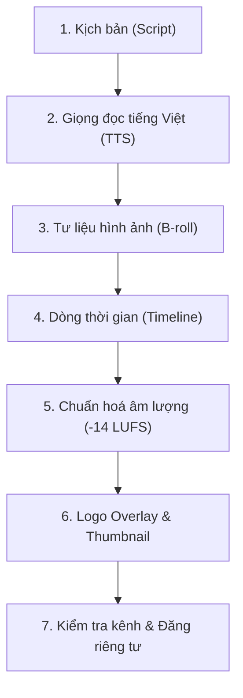

# Quy trình Sản xuất Video YouTube — Local Content Studio

Local Content Studio cho phép bạn kết hợp sức mạnh của AI Agent để tự động hóa trọn vẹn quy trình sản xuất một video YouTube chuẩn phát hành từ một câu lệnh duy nhất: từ viết kịch bản, đọc lời thoại tiếng Việt, dựng cảnh hình ảnh, ghép timeline, chuẩn hóa âm thanh, gắn logo thương hiệu, tạo ảnh bìa thumbnail cho đến xuất bản an toàn ở chế độ riêng tư.

> [!TIP]
> Trước khi xuất bản video lên kênh, hãy đảm bảo bạn đã kết nối tài khoản YouTube một lần theo hướng dẫn chi tiết tại: [Hướng dẫn kết nối YouTube](./ket-noi-youtube.md).

---

## Quy trình 7 bước sản xuất video với Agent

Bạn có thể bắt đầu ngay từ màn hình **Home** (`Ctrl+1`) hoặc trong một **Dự án** (`Ctrl+2`) bằng cách nhập yêu cầu vào ô chat:
> *"Làm video YouTube 60–90 giây giới thiệu về cách pha cà phê phin Việt Nam theo phong cách thương hiệu demo."*

Agent sẽ tuần tự triển khai 7 bước tự động như sau:

---

### Bước 1: Soạn kịch bản (Script)
- Agent dựa trên chủ đề yêu cầu và quy chuẩn giọng điệu của Brand để viết kịch bản phân cảnh chi tiết.
- Kịch bản bao gồm: lời đọc thuyết minh (voiceover), mô tả phân cảnh hình ảnh (visual prompt) và các mốc chuyển cảnh phù hợp với thời lượng 60–90 giây.

### Bước 2: Sinh giọng đọc tiếng Việt (TTS)
- Agent sử dụng công cụ tổng hợp giọng đọc ngoại tuyến chất lượng cao: **Piper TTS** (mô hình tiếng Việt `vi_VN-vais1000-medium`) hoặc **VieNeu-TTS / Windows SAPI**.
- Giọng đọc được cắt thành các đoạn tệp âm thanh `.wav` theo từng phân cảnh. Hệ thống tự động đo thời lượng chính xác đến từng mili-giây của từng câu để chuẩn bị cho bước dựng hình.

### Bước 3: Chuẩn bị tư liệu hình ảnh & B-roll
- Với mỗi phân cảnh, agent tìm kiếm trong Thư viện tài nguyên có sẵn hoặc gọi công cụ tạo ảnh AI (qua Gateway kết nối OpenAI Images / Flux).
- Nếu không sử dụng ảnh AI, agent có thể tự thiết kế các thẻ cảnh (artboards) bằng HTML/CSS theo đúng font chữ và mã màu của Brand, sau đó render thành ảnh PNG sắc nét.

### Bước 4: Dựng dòng thời gian video (Timeline)
- Agent tạo tệp cấu hình `timeline.json` kết nối các luồng dữ liệu:
  - **Track video chính (Base track):** Nối tiếp các cảnh hình ảnh khớp hoàn toàn với thời lượng lời đọc, có hiệu ứng chuyển cảnh mượt mà.
  - **Track âm thanh (Audio track):** Đặt các đoạn thoại tiếng Việt liên tục không bị ngắt quãng.
  - **Track phụ đề (Subtitles):** Tự động bẻ câu thông minh (tối đa 2 dòng, khoảng 42 ký tự/dòng) để người xem dễ theo dõi trên mọi thiết bị.
- Agent dựng timeline bằng công cụ `timeline_build` của Studio: tự đo thời lượng từng đoạn giọng đọc, xếp ảnh/clip nền nối tiếp, chia phụ đề theo câu và đặt logo lên lớp phủ — bạn không phải duyệt lệnh nào cho bước này.

### Bước 5: Chuẩn hóa âm lượng chuẩn YouTube (−14 LUFS)
- YouTube yêu cầu âm lượng tổng thể đạt chuẩn **−14 LUFS** để video không bị quá nhỏ so với các video khác hoặc bị nền tảng tự động hạ âm lượng do méo tiếng.
- Bộ kết xuất video của Studio tự động áp dụng bộ lọc chuẩn hóa `loudnorm` của FFmpeg khi render file MP4, bảo đảm chỉ số Integrated Loudness đạt mức chuẩn (−13.6 đến −14.0 LUFS), được kiểm chứng qua công cụ kiểm tra âm thanh nội bộ.

### Bước 6: Chèn Logo thương hiệu (Logo Overlay) & Tạo Thumbnail
- **Lớp phủ logo (Overlay track):** Logo của Brand được đặt ở track overlay video (thường ở góc trên bên phải màn hình), căn chỉnh toạ độ X/Y, kích thước và độ mờ (opacity) phù hợp.
  > [!NOTE]
  > Bộ dựng FFmpeg không hỗ trợ trực tiếp tệp vector `.svg` trong timeline video. Agent sẽ tự động chuyển logo SVG sang tệp PNG trước khi chèn vào lớp phủ.
- **Tạo ảnh bìa (Thumbnail):** Agent tạo một thiết kế thumbnail chuẩn độ phân giải **1280×720** (tỉ lệ 16:9), phối hợp màu sắc nổi bật, chữ tiêu đề cuốn hút và logo thương hiệu rõ nét.

### Bước 7: Kiểm tra tiêu chuẩn kênh & Chuẩn bị đăng
1. Ấn phẩm video MP4 và ảnh Thumbnail được chuyển qua **Ma trận Kênh** trong bảng Outputs để kiểm tra:
   - Độ phân giải: 1920×1080 (Full HD) cho video ngang, 1280×720 cho thumbnail.
   - Bảng màu nhận diện, độ tương phản chữ, sự hiện diện của logo và phụ đề.
2. Khi mọi tiêu chí đạt dấu tích xanh **`✓`**, agent gọi lệnh tạo bản nháp xuất bản (`publish_prepare`).
3. Tệp video, thumbnail và siêu dữ liệu (tiêu đề, mô tả, từ khoá thẻ tags, hashtags) được đóng gói sẵn sàng.

---

## Xác nhận xuất bản an toàn (Mặc định Riêng tư)

Studio luôn tuân thủ nguyên tắc **an toàn tuyệt đối: AI không bao giờ được tự ý bấm đăng công khai**:

1. Khi bản nháp đã sẵn sàng, bạn mở bảng **Outputs** (`Ctrl+Alt+B`) → Bấm nút **Đăng…**
2. Cửa sổ xuất bản hiển thị thông tin chi tiết:
   - Tên video, mô tả, các thẻ tags (có bộ đếm ký tự trực quan).
   - Ảnh bìa thumbnail đi kèm.
   - Chế độ hiển thị: **Luôn mặc định chọn "Riêng tư" (Private)**.
3. Bấm **Tiếp tục xác nhận** để rà soát lại thông tin lần cuối.
4. Bấm **Xác nhận đăng lên YouTube**. Studio sẽ tải tệp lên qua giao thức tải lên tiếp tục được (Resumable Upload) an toàn.
5. Sau khi hoàn tất, bạn có thể vào YouTube Studio để xem trước video trong danh sách video riêng tư của mình trước khi quyết định chuyển sang công khai.

---

## Xử lý khi gặp sự cố

| Hiện tượng | Nguyên nhân | Cách khắc phục |
| :--- | :--- | :--- |
| Agent báo lỗi khi chèn file logo vào video | File logo có định dạng `.svg` được đưa trực tiếp vào track overlay | Yêu cầu agent render file SVG sang PNG thông qua design artifact trước khi ghép vào timeline. |
| Ma trận kênh báo lỗi `DIMENSIONS_MISMATCH` ở ô Thumbnail | Kênh YouTube yêu cầu ảnh bìa 1280×720 nhưng file render ra kích thước khác | Nhấp vào ô lỗi, bấm "Nhờ agent sửa" để agent điều chỉnh lại kích thước trong `artifact.yaml`. |
| Âm lượng video nghe nhỏ hơn chuẩn | Chưa áp dụng bộ lọc chuẩn hóa âm thanh | Đảm bảo cấu hình kênh YouTube trong `channels/youtube.yaml` có khai báo `loudness_lufs: -14`. |
| Quá trình upload báo lỗi chưa cấu hình tài khoản | Chưa hoàn tất nạp OAuth Client ID và Secret của Google | Mở **Tools & Cài đặt (`Ctrl+5`) › Tài khoản đăng bài** và làm theo [Hướng dẫn kết nối YouTube](./ket-noi-youtube.md). |
